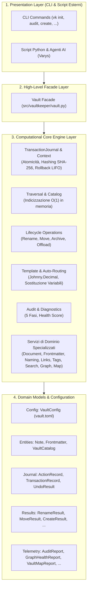

# Architettura di Sistema — Obsidian VaultKeeper

Questo documento definisce i principi architetturali, i pattern di progettazione e le convenzioni strutturali alla base di **`obsidian-vaultkeeper`** (`vk`).

---

## 1. Visione d'Insieme & Filosofia Architetturale

`obsidian-vaultkeeper` è un motore di governance per archivi documentali basati su Markdown e Second Brain Obsidian. 
È ingegnerizzato secondo una **Layered Architecture** a quattro livelli con dipendenze rigorosamente monodirezionali:



---

## 2. I Cinque Pilastri Ingegneristici

### A. Facade Pattern Unificato ([`Vault`](file:///home/lucadileo9/scripts/obsidian-vaultkeeper/docs/architecture/facade.md))
Nessun client esterno (né la CLI né uno script o una Skill di Varys) invoca direttamente i moduli interni del core. Tutte le interazioni transitano attraverso l'unica classe [`Vault`](file:///home/lucadileo9/scripts/obsidian-vaultkeeper/src/vaultkeeper/vault.py), che coordina configurazione, cache in memoria e apertura delle transazioni.

### B. Pure Computational Headless API
Tutti i metodi del Core e della Facade sono puramente computazionali:
- **Zero chiamate a `print()` o `sys.exit()`**: L'output per l'utente è confinato esclusivamente nel presentation layer.
- **Ritorno di modelli immutabili tipizzati**: I metodi restituiscono dataclass fortemente tipizzate o tuple primitive.
- **Eccezioni gerarchiche dedicate**: Errori operativi o violazioni di governance sollevano sottoclassi di `VaultKeeperError` (`CreationError`, `NamingError`, `TaxonomyError`, `UndoConflictError`, `VaultNotFoundError`).

### C. Write-Ahead Action Journaling & Rollback LIFO ([`transaction_journal.md`](file:///home/lucadileo9/scripts/obsidian-vaultkeeper/docs/architecture/transaction_journal.md))
Tutte le mutazioni su filesystem (creazione, rinomina, spostamento, archiviazione, offload, alterazione frontmatter, modifica tag) vengono eseguite all'interno di un blocco [`TransactionContext`](file:///home/lucadileo9/scripts/obsidian-vaultkeeper/src/vaultkeeper/core/journal.py#L23-L229).
- Viene registrato l'hash crittografico SHA-256 pre e post mutazione.
- Se il blocco fallisce con un'eccezione, il context manager applica un **auto-rollback in-memory immediato**.
- In fase di `vk undo`, un controllo pre-flight verifica che nessun file sia stato modificato esternamente (anti-conflitto), prima di disfare le micro-azioni in ordine strettamente inverso (**LIFO**).

### D. Indicizzazione $O(1)$ in Memoria (`VaultCatalog`)
Per evitare accessi ricorsivi ripetuti a disco durante l'esecuzione di comandi complessi (es. riscrittura globale dei wikilink o audit), [`VaultCatalog`](file:///home/lucadileo9/scripts/obsidian-vaultkeeper/docs/architecture/models.md#vaultcatalog) mappa in memoria tutti gli stem normalizzati, nomi file e percorsi. 
Qualsiasi operazione mutativa invoca automaticamente `Vault.refresh()`, invalidando la cache in modo trasparente.

### E. Rigida Separazione dei Modelli di Dominio ([`models.md`](file:///home/lucadileo9/scripts/obsidian-vaultkeeper/docs/architecture/models.md))
I 23 modelli di dominio sono ripartiti in 5 moduli ad alta coesione all'interno di `vaultkeeper.models/` (`config`, `entities`, `journal`, `results`, `telemetry`), azzerando le dipendenze circolari ed esponendo un contratto retrocompatibile in `__all__`.

---

## 3. Mappa Strutturale del Repository

```text
obsidian-vaultkeeper/
├── pyproject.toml              # Definizione pacchetto, dipendenze (Click, Rich, PyYAML, Proteus) e tool config
├── README.md                   # Landing page esecutiva, quickstart e quick reference CLI
├── ARCHITECTURE.md             # Questo documento
├── src/
│   └── vaultkeeper/
│       ├── __init__.py         # Esportazione versione e classe Vault
│       ├── config.py           # Caricamento e validazione vault.toml
│       ├── exceptions.py       # Gerarchia delle eccezioni tipizzate di sistema
│       ├── vault.py            # Facade principale ad alto livello
│       ├── cli/                # Presentation Layer (CLI vk)
│       │   ├── constants.py    # ExitCode (0=SUCCESS, 1=ERROR, 2=ISSUES_FOUND)
│       │   ├── logging.py      # Logger ANSI su terminale e strip ANSI su file log
│       │   ├── main.py         # Parser argparse e router comandi
│       │   └── commands/       # I 20 moduli specializzati dei singoli comandi CLI
│       ├── core/               # Motore computazionale puro (15 moduli headless)
│       │   ├── attachments.py  # Bonifica allegati orfani e pesanti (>50MB)
│       │   ├── audit.py        # Diagnostica in 5 fasi e Vault Health Score
│       │   ├── document.py     # MarkdownDocument con preservazione byte
│       │   ├── frontmatter.py  # Parsing YAML e validazione metadati
│       │   ├── graph.py        # Analisi topologica del grafo (hubs, orfani)
│       │   ├── indices.py      # Generazione MOC 00_Indice.md di cartella
│       │   ├── journal.py      # TransactionJournal e Context Manager atomico
│       │   ├── lifecycle.py    # Rinomina, spostamento, archiviazione e offload
│       │   ├── links.py        # Risoluzione wikilink ed embed secondo Obsidian
│       │   ├── map.py          # Cartografia strutturale Johnny.Decimal
│       │   ├── naming.py       # Title_Case, pulizia caratteri speciali, acronimi
│       │   ├── search.py       # Motore di ricerca semantico multi-filtro
│       │   ├── taxonomy.py     # Vocabolario controllato in 00_Tassonomia_Tag.md
│       │   ├── templates.py    # TemplateEngine e auto-routing Johnny.Decimal
│       │   └── traversal.py    # Scansione sicura filesystem e costruttore VaultCatalog
│       ├── models/             # Modelli di dominio suddivisi in 5 moduli specializzati
│       │   ├── config.py       # VaultConfig
│       │   ├── entities.py     # Frontmatter, Note, VaultCatalog
│       │   ├── journal.py      # ActionRecord, TransactionRecord, UndoResult
│       │   ├── results.py      # Modelli di esito delle mutazioni
│       │   └── telemetry.py    # Modelli diagnostici e di telemetria
│       └── utils/              # Formattatori Rich/JSON/YAML e funzioni ausiliarie
├── docs/                       # Documentazione tecnica approfondita
│   ├── architecture/           # Facade, Core Modules, Domain Models, Journal
│   ├── cli/                    # Panoramica CLI e manuale dei 20 comandi
│   └── testing/                # Strategia di test, fixture e matrici CI
└── tests/                      # Suite di collaudo con 153 test e 90% coverage
```

---

## 4. Guida all'Estensione del Sistema

### Come Aggiungere un Nuovo Metodo alla Facade
1. Implementare la logica algoritmica pura all'interno del modulo appropriato in `src/vaultkeeper/core/`.
2. Se l'operazione comporta mutazioni sul filesystem:
   - Ricevere un parametro opzionale `transaction: Optional[TransactionContext] = None`.
   - Utilizzare `transaction.write_content()`, `transaction.move_file()`, `transaction.create_file()` o `transaction.delete_file()`.
3. Esporre il metodo in [`Vault`](file:///home/lucadileo9/scripts/obsidian-vaultkeeper/src/vaultkeeper/vault.py), incapsulandone l'esecuzione all'interno di `with self.journal.begin_transaction(...) as tx:` se mutativo.
4. Concludere con `self.refresh()` per invalidare l'indice in memoria.
5. Aggiungere test unitari in `tests/test_vault.py` e nel modulo core di competenza.

### Come Aggiungere un Nuovo Comando CLI
1. Creare il modulo handler in `src/vaultkeeper/cli/commands/<nome>.py`.
2. Ricevere gli argomenti `args` e il `logger`, invocare il metodo corrispondente su `Vault` e formattare l'output con `OutputFormatter`.
3. Importare e registrare il comando nel router `main.py` aggiungendo il sotto-parser con argomenti ed help.
4. Restituire un codice standard `ExitCode.SUCCESS`, `ExitCode.ERROR` o `ExitCode.ISSUES_FOUND`.
5. Aggiungere il test end-to-end in `tests/test_cli*.py`.

---

## 5. Indice Documentale Dettagliato

- [**Facade Unificata (`docs/architecture/facade.md`)**](docs/architecture/facade.md): Disamina di tutti i metodi esposti e diagrammi di sequenza.
- [**Catalogo Moduli Core (`docs/architecture/core_modules.md`)**](docs/architecture/core_modules.md): I 15 moduli computazionali disaminati file per file.
- [**Modelli di Dominio (`docs/architecture/models.md`)**](docs/architecture/models.md): Specifiche dei 23 dataclass immutabili.
- [**Transaction Journal & Rollback (`docs/architecture/transaction_journal.md`)**](docs/architecture/transaction_journal.md): Meccanica dello stato, hashing SHA-256 e LIFO.
- [**Panoramica della CLI (`docs/cli/overview.md`)**](docs/cli/overview.md): Exit code, opzioni globali e tabella sinottica.
- [**Riferimento dei 20 Comandi CLI (`docs/cli/commands_reference.md`)**](docs/cli/commands_reference.md): Guida approfondita a tutti i comandi con esempi ed output.
- [**Architettura Test Suite (`docs/testing/test_suite.md`)**](docs/testing/test_suite.md): 153 test, copertura 90%, matrici CI e sicurezza con Bandit.
