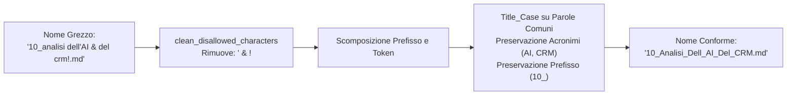
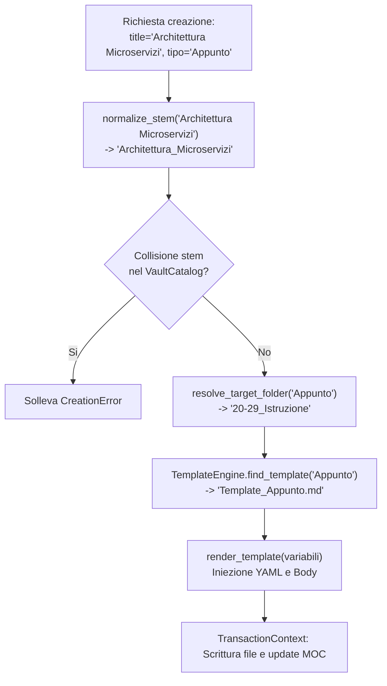

# Catalogo del Motore Computazionale (Core Modules)

La cartella [`src/vaultkeeper/core/`](file:///home/lucadileo9/scripts/obsidian-vaultkeeper/src/vaultkeeper/core) racchiude l'intelligenza algoritmica di `obsidian-vaultkeeper`.
Ciascun modulo è progettato per operare in modalità headless, disaccoppiato da interfacce utente o formattatori di terminale, esponendo funzioni pure o classi specializzate che manipolano modelli di dominio immutabili.

---

## Mappa Architetturale dei Moduli Core

```mermaid
flowchart TD
    subgraph Fondamenta Filesystem
        TRV["traversal.py<br/>(Scansione O(1) e Catalogo)"]
        DOC["document.py<br/>(Manipolazione Byte-Perfect)"]
        FMT["frontmatter.py<br/>(Parsing YAML e Metadati)"]
    end

    subgraph Affidabilita e Transazioni
        JRN["journal.py<br/>(Journaling e Rollback LIFO)"]
    end

    subgraph Igiene e Naming
        NAM["naming.py<br/>(Title_Case e Normalizzazione)"]
        ATT["attachments.py<br/>(Allegati Orfani e Pesanti)"]
        TAX["taxonomy.py<br/>(Vocabolario Controllato Tag)"]
    end

    subgraph Navigazione e Struttura
        LNK["links.py<br/>(Risoluzione Wikilink ed Embed)"]
        IND["indices.py<br/>(Generatore MOC di Cartella)"]
        TMP["templates.py<br/>(Template e Auto-Routing)"]
    end

    subgraph Ciclo di Vita Avanzato
        LIF["lifecycle.py<br/>(Rinomina, Spostamento, Archiviazione)"]
    end

    subgraph Diagnostica e Telemetria
        AUD["audit.py<br/>(Audit a 5 Fasi e Health Score)"]
        GPH["graph.py<br/>(Topologia della Rete Concettuale)"]
        MAP["map.py<br/>(Cartografia Johnny.Decimal)"]
        SCH["search.py<br/>(Ricerca Semantica Multi-Criterio)"]
    end

    TRV --> LNK
    TRV --> AUD
    TRV --> GPH
    TRV --> SCH
    DOC --> LIF
    FMT --> DOC
    FMT --> TAX
    FMT --> IND
    NAM --> LIF
    LNK --> LIF
    IND --> LIF
    JRN -.-> LIF
    JRN -.-> ATT
    JRN -.-> TMP
    TMP --> LIF
```

---

## 1. `traversal.py` — Scansione e Indicizzazione del Filesystem

### Scopo e Responsabilità
Fornisce gli strumenti per percorrere l'albero delle cartelle del Vault in modo sicuro, escludendo cartelle nascoste o di sistema (`.obsidian`, `.trash`, `.git`, `.venv`) e costruendo l'indice in memoria [`VaultCatalog`](file:///home/lucadileo9/scripts/obsidian-vaultkeeper/docs/architecture/models.md#vaultcatalog).

### Dipendenze
- **Usa:** `VaultConfig`, `VaultCatalog` da `vaultkeeper.models`.
- **Usato da:** `Vault.catalog`, `audit.py`, `links.py`, `indices.py`, `search.py`, `lifecycle.py`.

### Funzioni Esposte

#### `build_vault_catalog(config: VaultConfig) -> VaultCatalog`
- **Descrizione:** Esegue una scansione completa del Vault e popola l'indice in memoria $O(1)$.
- **Parametri:** `config`: configurazione attiva del Vault.
- **Ritorno:** Istanza di `VaultCatalog` contenente la mappa `{stem: [path1, ...]}` e i set di nomi file e percorsi relativi.
- **Effetti collaterali:** Lettura ricorsiva del filesystem (sola lettura).

#### `walk_vault_files(config: VaultConfig, target_dir: Optional[Path] = None, filter_extensions: bool = True, extensions: Optional[Set[str]] = None) -> Iterator[Path]`
- **Descrizione:** Generatore pigro che produce percorsi di file validi escludendo cartelle ignorate.
- **Parametri:**
  - `config`: regole di esclusione e configurazione.
  - `target_dir`: cartella di partenza opzionale (default radice del Vault).
  - `filter_extensions`: se `True`, applica il filtro su `config.allowed_extensions`.
  - `extensions`: insieme esplicito di estensioni consentite (es. `{".md"}`).
- **Ritorno:** Iteratore di oggetti `Path`.

#### `walk_vault_directories(config: VaultConfig, target_dir: Optional[Path] = None) -> Iterator[Path]`
- **Descrizione:** Generatore che produce percorsi di directory navigabili all'interno del Vault.

---

## 2. `document.py` — Astrazione Orientata agli Oggetti del Markdown

### Scopo e Responsabilità
Incapsula un file Markdown garantendo una manipolazione che preservi l'esatta formattazione preesistente: non altera i byte circostanti, rispetta i terminatori di riga nativi (`\r\n` su Windows, `\n` su POSIX) e consente modifiche atomiche a frontmatter, tag e wikilink.

### Dipendenze
- **Usa:** `Frontmatter` da `vaultkeeper.models`, `parse_note_content` e `update_frontmatter` da `.frontmatter`.
- **Usato da:** `Vault.get_document()`, `lifecycle.py`, test suite.

### Classe `MarkdownDocument`

#### Costruttori
- `from_file(file_path: Path, type_field: str = "tipo") -> MarkdownDocument`: Istanzia il documento leggendolo direttamente da disco con decodifica UTF-8.
- `from_string(content: str, type_field: str = "tipo", file_path: Optional[Path] = None) -> MarkdownDocument`: Istanzia il documento da stringa in memoria.

#### Proprietà
- `file_path: Optional[Path]`: Percorso associato al file.
- `frontmatter: Optional[Frontmatter]`: Oggetto con metadati YAML analizzati.
- `metadata: Dict[str, Any]`: Dizionario dizionario grezzo dei metadati.
- `tipo: Optional[str]`: Tipologia della nota.
- `tags: List[str]`: Elenco dei tag normalizzati.
- `body: str`: Corpo testuale privo del blocco frontmatter.
- `raw_content: str`: Contenuto testuale integrale.

#### Metodi di Mutazione
- `set_frontmatter_field(key: str, value: Any) -> None`: Aggiorna o aggiunge una chiave nel frontmatter YAML.
- `get_frontmatter_field(key: str, default: Any = None) -> Any`: Estrae un valore dal frontmatter.
- `add_tag(tag: str) -> bool`: Aggiunge un tag se non già presente (restituisce `True` se modificato).
- `remove_tag(tag: str) -> bool`: Rimuove un tag (restituisce `True` se presente e rimosso).
- `replace_wikilink(old_target: str, new_target: str) -> int`: Sostituisce tutte le occorrenze di `[[old_target]]` rispettando ancore (`#`) e alias (`|`), restituendo il numero di rimpiazzi.
- `save(transaction: Optional[Any] = None) -> None`: Persiste il documento su disco. Se fornita una transazione del Journal, la delega a `transaction.write_content()`.

---

## 3. `frontmatter.py` — Parsing e Manipolazione YAML

### Scopo e Responsabilità
Esegue il parsing dei metadati YAML posizionati all'inizio dei file Markdown, garantendo la compatibilità con le convenzioni di Obsidian e isolando direttive C o codici esadecimali dall'estrazione dei tag.

### Dipendenze
- **Usa:** `PyYAML` (`yaml.safe_load`), `Frontmatter`, `Note` da `vaultkeeper.models`.
- **Usato da:** `document.py`, `audit.py`, `indices.py`, `Vault.get_note()`.

### Funzioni Esposte

#### `parse_note_content(content: str, type_field: str = "tipo") -> Tuple[Optional[Frontmatter], str]`
- **Descrizione:** Separa il blocco frontmatter (`--- ... ---`) dal corpo della nota, restituendo l'oggetto `Frontmatter` e il corpo residuo. Se il frontmatter è assente o malformato, restituisce `(None, content)`.

#### `read_note(file_path: Path, vault_root: Path, type_field: str = "tipo") -> Note`
- **Descrizione:** Legge un file da disco e restituisce un'istanza disaccoppiata del modello `Note`.

#### `update_frontmatter(content: str, updates: Dict[str, Any]) -> str`
- **Descrizione:** Aggiorna selettivamente i campi specificati nel blocco frontmatter esistente o ne inietta uno nuovo se assente, preservando commenti e formattazione per quanto possibile.

#### `extract_inline_tags(text: str, protect_c: bool = True, protect_hex: bool = True) -> List[str]`
- **Descrizione:** Estrae i tag inline (`#tag/subtag`) dal corpo del testo, proteggendo direttive C (`#include`, `#define`) e colori esadecimali (`#AABBCC`).

#### `parse_taxonomy_file(taxonomy_file_path: Path) -> Set[str]`
- **Descrizione:** Legge un file di tassonomia controllata (es. `00_Tassonomia_Tag.md`) ed estrae l'insieme di tutti i tag censiti (inclusi elenchi puntati e tag con `#`).

#### `batch_set_type(vault_root, mapping, allowed_types, type_field="tipo", transaction=None, dry_run=False) -> List[Tuple[Path, bool]]`
- **Descrizione:** Applica in batch il valore del campo tipologico sulle note specificate. Implementa **Strict All-or-Nothing preflight**: se un tipo non è registrato in `allowed_types` o una nota non esiste, l'intero lotto viene abortito senza alcuna modifica.

#### `batch_add_tags(vault_root, mapping, allowed_taxonomy_tags=None, strict_taxonomy=False, overwrite=False, type_field="tipo", transaction=None, dry_run=False) -> List[Tuple[Path, bool]]`
- **Descrizione:** Inietta o sovrascrive tag in batch su note multiple. Con `strict_taxonomy=True`, esegue preflight per verificare che ogni tag sia registrato nel vocabolario controllato prima di applicare modifiche.

---

## 4. `naming.py` — Standardizzazione dei Nomi e Wikilink

### Scopo e Responsabilità
Garantisce la conformità dei nomi di file alle linee guida del Second Brain: conversione in `Title_Case_Con_Underscore`, rimozione di caratteri vietati da sistemi operativi o Obsidian (`:`, `?`, `*`, `\`, `|`), protezione degli acronimi (`AI`, `BCG`, `CRM`, `MECE`) e dei prefissi Johnny.Decimal (`10-19_`, `00_`).

### Funzioni Esposte

#### `clean_disallowed_characters(name: str, config: VaultConfig) -> str`
- **Descrizione:** Rimuove caratteri speciali illegali definiti nella regex `config.disallowed_chars_regex`.

#### `normalize_stem(name: str, config: VaultConfig) -> str`
- **Descrizione:** Normalizza lo stem di una nota (privo di estensione) applicando la convenzione configurata (es. `Title_Case`).

#### `normalize_name(name: str, config: VaultConfig, is_directory: bool = False) -> str`
- **Descrizione:** Normalizza un nome completo mantenendo l'estensione originale del file.

#### `update_wikilinks_in_content(content: str, old_stem: str, new_stem: str) -> Tuple[str, int]`
- **Descrizione:** Aggiorna tutte le occorrenze di `[[old_stem]]` in un testo Markdown rimpiazzandole con `[[new_stem]]`, preservando ancore (`#sezione`) e alias (`|alias`). Restituisce il testo modificato e il conteggio delle sostituzioni.

#### `batch_normalize(catalog: VaultCatalog, config: VaultConfig, target_dir: Optional[Path] = None, dry_run: bool = False, transaction: Optional[Any] = None) -> List[Tuple[Path, Path, int]]`
- **Descrizione:** Scansiona un'area del Vault e applica la normalizzazione a tutti i file non conformi, aggiornando i wikilink in ingresso in tutto il Vault.

---

## 5. `links.py` — Risoluzione Wikilink e Rilevamento Anomalie

### Scopo e Responsabilità
Implementa la logica di risoluzione dei collegamenti interni secondo le specifiche di Obsidian: risoluzione per stem esatto (senza percorso), risoluzione relativa, parsing di ancore e alias, rilevamento di link rotti ed embed multimediali orfani, mappatura delle collisioni di stem.

### Classe `WikilinkEngine`
- `config: VaultConfig`
- `parse_link(raw_target: str) -> Tuple[str, Optional[str], Optional[str]]`: Scompone `[[Target#Ancora|Alias]]` in `(clean_target, anchor, alias)`.
- `resolve_target(clean_target: str, catalog: VaultCatalog, current_file: Optional[Path] = None) -> Optional[Path]`: Risolve il percorso fisico corrispondente al target all'interno del catalogo.
- `extract_links_from_text(content: str) -> List[str]`: Estrae tutti i target di wikilink ed embed presenti nel testo.

### Funzioni Ausiliarie
- `scan_broken_links(catalog: VaultCatalog, config: VaultConfig, target_file_or_dir: Optional[Path] = None) -> List[BrokenLink]`: Rileva tutti i link del Vault che non puntano ad alcun file esistente.
- `find_stem_collisions(catalog: VaultCatalog) -> Dict[str, List[Path]]`: Individua note in cartelle diverse che condividono lo stesso stem normalizzato.

---

## 6. `attachments.py` — Igiene degli Allegati e File Pesanti

### Scopo e Responsabilità
Identifica file multimediali o documenti binari non referenziati da alcuna nota Markdown e rileva file che superano la soglia critica di peso (`heavy_file_threshold_mb`), consentendone la rimozione o l'archiviazione controllata.

### Funzioni Esposte
- `find_orphan_attachments(catalog: VaultCatalog, config: VaultConfig, target_dir: Optional[Path] = None) -> List[OrphanAttachment]`: Convalida ogni file presente nelle cartelle allegati contro l'insieme di tutti i wikilink ed embed estratti dalle note Markdown.
- `find_heavy_files(catalog: VaultCatalog, config: VaultConfig) -> List[Tuple[Path, int]]`: Elenca i file che superano la soglia configurata (default 50MB).
- `soft_delete_attachment(file_path: Path, vault_root: Path, trash_folder: str = ".trash", transaction: Optional[Any] = None) -> Path`: Trasferisce in modo reversibile un file nella cartella `.trash/`.
- `hard_delete_attachment(file_path: Path, transaction: Optional[Any] = None) -> None`: Elimina definitivamente un file registrando la possibilità di rollback nel Journal.

---

## 7. `indices.py` — Gestione MOC e Indici di Cartella

### Scopo e Responsabilità
Genera e mantiene aggiornati i file MOC (Map of Content) posizionati nelle cartelle del Vault (es. `00_Indice_Progetti.md` o `00_Indice.md`). Raggruppa le note per tipologia (`tipo`), include allegati e produce abstract sintetici ad alto segnale estratti da frontmatter, callout o primi paragrafi.

### Classe `IndexManager`
- `get_index_path(folder_path: Path) -> Path`: Restituisce il percorso previsto per il file indice della cartella secondo il pattern configurato (`contextual`, `static`, `readme`).
- `rebuild_index(folder_path: Path, transaction: Optional[Any] = None, dry_run: bool = False) -> Tuple[Path, bool]`: Rigenera integralmente il contenuto del file MOC scansionando i file della cartella.
- `add_note_to_index(folder_path, stem, title, tipo, abstract, transaction=None, dry_run=False) -> Tuple[Path, bool]`: Inserisce una singola voce nell'indice esistente preservando l'ordine alfabetico all'interno della sezione tipologica corretta.
- `remove_note_from_index(folder_path, stem, transaction=None, dry_run=False) -> Tuple[Path, bool]`: Rimuove il riferimento a una nota cancellata o spostata.

---

## 8. `lifecycle.py` — Rinomina, Spostamento, Archiviazione e Offload

### Scopo e Responsabilità
Orchestra le mutazioni ad alto impatto sistemico che coinvolgono molteplici componenti (filesystem, backlink globali e indici di cartella).

### Funzioni Chiave

#### `rename_item(...) -> RenameResult`
- Verifica l'assenza di collisioni preventive di stem.
- Rinomina il file sul disco.
- Scansiona l'intero Vault aggiornando tutti i wikilink in ingresso verso la nota.
- Risincronizza il file `00_Indice.md` della cartella.

#### `batch_rename_items(...) -> List[RenameResult]`
- Esegue la rinomina atomica di un elenco di note da dizionario mapping.
- **Strict All-or-Nothing preflight:**
  - Verifica l'esistenza di ciascun file sorgente.
  - Verifica l'assenza di collisioni di stem con note già presenti nel Vault.
  - Rileva collisioni intra-batch (due sorgenti mappate sullo stesso stem di destinazione).
  - In caso di anomalie, solleva eccezione immediata e modifica 0 file su disco.
- Se valido, processa ogni rinomina aggiornando wikilink e indici di cartella.

#### `move_item(...) -> MoveResult`
- Sposta una nota o cartella tra rami Johnny.Decimal.
- Rimuove la voce dal MOC della cartella di origine.
- Aggiunge la voce nel MOC della cartella di destinazione.

#### `batch_move_items(...) -> List[MoveResult]`
- Sposta atomicamente una collezione di note/cartelle verso le rispettive destinazioni.
- **Strict All-or-Nothing preflight:**
  - Verifica l'esistenza di tutte le sorgenti.
  - Verifica l'esistenza o creabilità delle cartelle di destinazione.
  - Verifica l'assenza di file già esistenti nelle posizioni target.
  - Rileva conflitti di duplicazione intra-batch (sorgenti distinte che produrrebbero lo stesso nome nella medesima cartella).
- Sincronizza coerentemente i MOC di tutte le cartelle coinvolte.

#### `archive_item(...) -> ArchiveResult`
- Sposta la nota o il progetto nella cartella speculare di Cold Storage (`/srv/storage/Archive`).
- Se `no_tombstone=False`, deposita nella posizione originale una nota tombstone con metadati storici, estratto sintetico e wikilink verso l'archivio.
- Aggiorna il MOC locale.

#### `offload_media(...) -> OffloadResult`
- Rileva allegati pesanti (>50MB).
- Li sposta nel cold storage.
- Rimpiazza i collegamenti interni con schede di riferimento.

---

## 9. `taxonomy.py` — Vocabolario Controllato dei Tag

### Scopo e Responsabilità
Presidia la governance dei tag del Second Brain. Si interfaccia con il file `00_Tassonomia_Tag.md`, consentendo di validare i tag, effettuare ricerche gerarchiche e applicare mutazioni su scala globale con aggiornamento sincronizzato di tassonomia e note.

### Classe `TaxonomyEngine`
- `load_taxonomy() -> Dict[str, List[str]]`: Carica e organizza i tag per sezione semantica.
- `is_valid_tag(tag: str) -> bool`: Verifica se un tag è censito nel vocabolario controllato.
- `search_tags(query: Optional[str] = None) -> List[str]`: Ricerca tag per prefisso o sottostringa.
- `add_tag(tag: str, section: Optional[str] = None, transaction=None, dry_run=False) -> TagMutationResult`: Aggiunge un tag in ordine alfabetico nella sezione corretta del file di tassonomia.
- `remove_tag(tag: str, force: bool = False, transaction=None, dry_run=False) -> TagMutationResult`: Rimuove un tag dalla tassonomia e da tutte le note che lo utilizzano.

---

## 10. `templates.py` — Motore di Templating e Auto-Routing

### Scopo e Responsabilità
Gestisce la creazione standardizzata di note. Trova il template corretto per tipologia, sostituisce variabili contestuali (`{{title}}`, `{{date}}`, `{{stem}}`, `{{tags}}`) e calcola la cartella di destinazione appropriata secondo lo standard Johnny.Decimal.

### Funzioni e Classi
- **`resolve_target_folder(vault_root: Path, tipo: str, custom_folder: Optional[Union[str, Path]] = None) -> Path`**:
  - `Progetto` $\rightarrow$ `10-19_Progetti`
  - `Contatto` $\rightarrow$ `30-39_Carriera/32_CRM`
  - `Appunto` $\rightarrow$ `20-29_Istruzione`
  - `Risorsa` $\rightarrow$ `20-29_Istruzione`
  - `Sistema` $\rightarrow$ `01-09_Risorse_Di_Sistema`
- **`TemplateEngine`**:
  - `list_templates() -> List[str]`
  - `resolve_template_path(template_name: str) -> Optional[Path]`
  - `find_template(tipo: str) -> Optional[Path]`
  - `render_template(raw_content, title, stem, tipo, tags, extra_vars=None) -> str`

---

## 11. `audit.py` — Diagnostica a 5 Fasi e Vault Health Score

### Scopo e Responsabilità
Ispeziona l'intero Vault valutandone la conformità agli standard di governance attraverso 5 fasi sequenziali e calcola il punteggio unificato `health_score` (0.0 - 100.0).

### Le 5 Fasi di Diagnostica

| Fase | Denominazione | Controlli Eseguiti | Penalità Health Score |
| :---: | :--- | :--- | :--- |
| **1** | Storage & Filesystem | Lunghezza percorsi (`max_path_length`), estensioni non consentite, file pesanti. | -2.0 per percorso errato, -1.0 per estensione non valida |
| **2** | Naming Conventions | Violazioni della convenzione Title_Case, caratteri speciali non consentiti. | -0.5 per violazione di denominazione |
| **3** | Frontmatter & Types | Assenza blocco YAML, campi obbligatori mancanti, tipologia (`tipo`) non autorizzata. | -1.5 per frontmatter errato o mancante |
| **4** | Tag Taxonomy | Tag non registrati nel vocabolario controllato (se `strict_taxonomy=True`). | -0.5 per tag non autorizzato |
| **5** | Links & Attachments | Wikilink rotti, embed multimediali orfani, collisioni di stem, allegati non referenziati. | -3.0 per link o embed rotto |

### Funzione Principale
- `run_audit(config: VaultConfig, phases_to_run: Optional[List[int]] = None) -> AuditReport`: Esegue le fasi selezionate e restituisce il report completo.

---

## 12. `search.py` — Motore di Ricerca Semantica Multi-Criterio

### Scopo e Responsabilità
Permette l'interrogazione mirata del patrimonio informativo del Vault senza scansioni integrali del disco, combinando filtri strutturati (cartella, tipo, tag, backlink) con ricerca testuale libera nel titolo o nel corpo, restituendo snippet di anteprima contestualizzati.

### Classe `SearchEngine`
- `search(query=None, tag=None, tipo=None, links_to=None, folder=None) -> SearchResult`: Applica i filtri congiuntamente (AND logico) sfruttando il catalogo in memoria.

---

## 13. `graph.py` — Analisi Topologica del Grafo Concettuale

### Scopo e Responsabilità
Analizza le relazioni tra i concetti del Second Brain con un approccio topologico non punitivo: quantifica il grado di centralità delle note, identifica i nodi cardine (*top hubs*), i vicoli ciechi (*dead-ends*), i veri orfani (note isolate con grado 0) e isola le componenti connesse indipendenti.

### Classe `GraphTelemetry`
- `analyze() -> GraphHealthReport`: Costruisce la matrice di adiacenza del Vault e calcola tutte le metriche topologiche della rete.

---

## 14. `map.py` — Cartografia Strutturale Johnny.Decimal

### Scopo e Responsabilità
Genera la vista cartografica d'insieme del Vault, riassumendo per ciascuna cartella primaria e secondaria il numero di note, di allegati, il peso in byte e la presenza o assenza del file MOC `00_Indice.md`.

### Classe `VaultMapEngine`
- `generate_report() -> VaultMapReport`: Calcola la telemetria per tutte le aree.
- `render_markdown_map(report: VaultMapReport) -> str`: Trasforma il report in una tabella leggibile conforme al Markdown di Obsidian.
- `write_map_file(output_path: Path, report: VaultMapReport) -> Path`: Persiste la mappa generata su file.

---

## 15. `journal.py` — Motore Transazionale

Modulo dedicato alla gestione delle transazioni atomiche e del rollback LIFO con verifica SHA-256 anti-conflitto.
La disamina approfondita di questo modulo è documentata integralmente in [`docs/architecture/transaction_journal.md`](file:///home/lucadileo9/scripts/obsidian-vaultkeeper/docs/architecture/transaction_journal.md).
