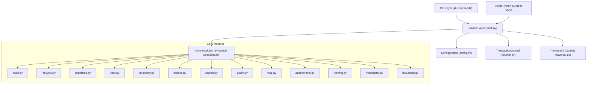
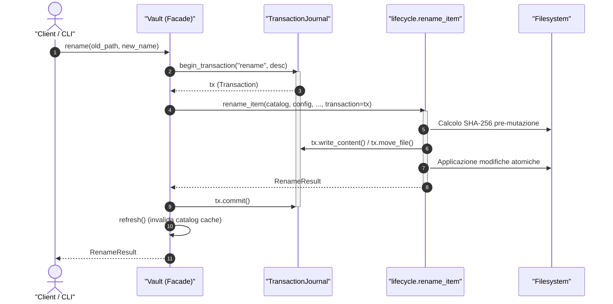
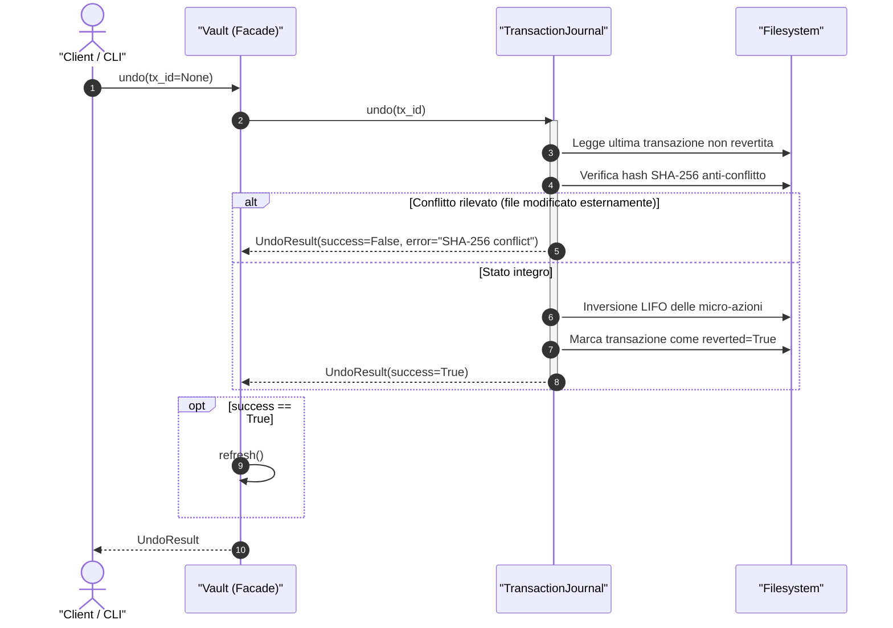

# Facade Unificata (`vaultkeeper.vault.Vault`)

La classe `Vault` (definita in [`src/vaultkeeper/vault.py`](file:///home/lucadileo9/scripts/obsidian-vaultkeeper/src/vaultkeeper/vault.py)) costituisce il **punto di ingresso unico ad alto livello** per l'interazione con un Vault Obsidian o un archivio documentale.

Implementa il pattern architetturale **Facade**, nascondendo la complessità dei 14 moduli del Core Engine dietro un'interfaccia coerente, fortemente tipizzata e priva di effetti collaterali indesiderati.

---

## 1. Principi di Progettazione e Invarianti

1. **Headless & Pure Computational API**:
   - Nessun metodo della Facade invoca `sys.exit()`, `print()`, `input()` o formattatori di presentazione.
   - In caso di anomalia o violazione delle regole di governance, la Facade solleva eccezioni tipizzate derivate da `VaultKeeperError` (`CreationError`, `FrontmatterError`, `TaxonomyError`, `VaultNotFoundError`, `JournalConflictError`).
   - L'output di ogni operazione è un Domain Model immutabile o una struttura dati standard Python.
2. **Atomic Journaling Trasparente**:
   - Qualsiasi metodo che provochi mutazioni sul filesystem (creazione, rinomina, spostamento, archiviazione, offload, alterazione frontmatter, modifica tag) apre automaticamente una transazione gestita nel `TransactionJournal`.
   - Se un'operazione parziale fallisce, l'eccezione viene propagata e le azioni già intraprese vengono sottoposte a rollback.
3. **In-Memory Catalog Caching e Refresh**:
   - L'indice di secondo livello [`VaultCatalog`](file:///home/lucadileo9/scripts/obsidian-vaultkeeper/docs/architecture/models.md#vaultcatalog) è calcolato in modalità *lazy* alla prima consultazione e mantenuto in memoria per azzerare accessi ridondanti a disco ($O(1)$).
   - Ogni operazione mutativa che altera percorsi o file invoca automaticamente `self.refresh()`, invalidando la cache per garantire consistenza assoluta.

---

## 2. Architettura delle Dipendenze

La Facade funge da intermediario esclusivo tra il Presentation Layer e il Core Engine.

---

## 3. Diagrammi di Sequenza

### Flusso di Mutazione Transazionale (es. `rename`)

### Flusso di Rollback Atomico (`undo`)

---

## 4. Riferimento Metodi della Facade

### Inizializzazione e Stato

#### `__init__(root_path=None, config_file=None)`
- **Scopo:** Inizializza l'istanza di `Vault`. Carica la configurazione da `vault.toml` (o applica i valori predefiniti) e predispone il `TransactionJournal`.
- **Parametri:**
  - `root_path (Optional[Union[str, Path]])`: Percorso assoluto della radice del Vault. Se omesso, viene ricercato risalendo l'albero delle directory.
  - `config_file (Optional[Union[str, Path]])`: Percorso esplicito di un file di configurazione TOML.
- **Ritorno:** Istanza di `Vault`.

#### `root -> Path`
- **Scopo:** Proprietà in sola lettura che restituisce il percorso assoluto della radice del Vault.

#### `catalog -> VaultCatalog`
- **Scopo:** Proprietà in sola lettura che restituisce l'indice in memoria del Vault. Se non ancora inizializzato, invoca `build_vault_catalog()` e ne memorizza il riferimento.

#### `refresh() -> None`
- **Scopo:** Invalida esplicitamente la cache di `VaultCatalog` impostandola a `None`.

#### `get_note(file_path: Union[str, Path]) -> Note`
- **Scopo:** Legge e deserializza una nota Markdown, estraendo frontmatter e corpo.
- **Parametri:** `file_path`: percorso relativo o assoluto della nota.
- **Ritorno:** Oggetto `Note`.

#### `get_document(file_path: Union[str, Path]) -> MarkdownDocument`
- **Scopo:** Restituisce un'istanza orientata agli oggetti di `MarkdownDocument` per manipolazioni mirate del contenuto senza alterazione dei byte non coinvolti.

---

### Diagnostica, Integrità e Cartografia

#### `audit(phases: Optional[List[int]] = None) -> AuditReport`
- **Scopo:** Esegue la suite diagnostica in 5 fasi del Second Brain e restituisce il referto quantitativo e qualitativo.
- **Parametri:** `phases`: lista opzionale di ID di fase da eseguire (es. `[1, 2]`). Se `None`, esegue tutte le 5 fasi.
- **Ritorno:** `AuditReport` contenente l'elenco dei `PhaseResult` e il punteggio `health_score`.

#### `check_links(target: Optional[Union[str, Path]] = None) -> List[BrokenLink]`
- **Scopo:** Scansiona le note individuando tutti i wikilink ed embed multimediali non risolti.
- **Parametri:** `target`: file o cartella opzionale da circoscrivere. Se `None`, estende l'analisi all'intero Vault.
- **Ritorno:** Lista di istanze `BrokenLink`.

#### `stem_collisions() -> Dict[str, List[Path]]`
- **Scopo:** Rileva collisioni di nomi, ovvero note collocate in cartelle differenti che condividono il medesimo stem normalizzato.
- **Ritorno:** Dizionario `{stem: [path1, path2, ...]}` per tutti gli stem con due o più occorrenze.

#### `graph_health() -> GraphHealthReport`
- **Scopo:** Esegue un'analisi topologica non punitiva della rete concettuale del Vault.
- **Ritorno:** `GraphHealthReport` con veri orfani, vicoli ciechi, nodi hub e componenti disconnesse.

#### `vault_map(output_file: Optional[Union[str, Path]] = None) -> Tuple[VaultMapReport, Optional[Path]]`
- **Scopo:** Rileva le metriche delle aree Johnny.Decimal (conteggio note, allegati, peso in byte, presenza MOC).
- **Parametri:** `output_file`: percorso opzionale in cui depositare la mappa in formato Markdown.
- **Ritorno:** Tupla `(VaultMapReport, percorso_file_scritto_o_none)`.

---

### Gestione Allegati

#### `find_orphans(target: Optional[Union[str, Path]] = None) -> List[OrphanAttachment]`
- **Scopo:** Identifica file binari o documenti presenti su disco ma non citati in alcuna nota.
- **Ritorno:** Lista di `OrphanAttachment`.

#### `find_heavy_files() -> List[Tuple[Path, int]]`
- **Scopo:** Identifica allegati che superano la soglia configurata (`heavy_file_threshold_mb`, default 50MB).
- **Ritorno:** Lista di tuple `(file_path, dimensione_in_byte)`.

#### `clean_attachments(target=None, hard_delete=False, dry_run=False) -> List[Tuple[Path, Optional[Path]]]`
- **Scopo:** Bonifica gli allegati orfani trasferendoli nel cestino `.trash` (soft-delete) o eliminandoli definitivamente.
- **Transazionale:** Sì (registra `clean-attachments` nel Journal se `not dry_run`).
- **Ritorno:** Lista di tuple `(percorso_originale, percorso_destinazione_o_none)`.

#### `offload(target=None, dry_run=False) -> OffloadResult`
- **Scopo:** Trasferisce allegati pesanti o file specifici verso l'archivio a freddo (`archive_path`), rimpiazzando i collegamenti interni con schede di puntamento.
- **Transazionale:** Sì (registra `offload` nel Journal).
- **Ritorno:** `OffloadResult`.

---

### Standardizzazione, Naming e Frontmatter

#### `normalize_names(target=None, dry_run=False) -> List[Tuple[Path, Path, int]]`
- **Scopo:** Normalizza ricorsivamente i nomi di file secondo lo standard Title_Case (preservando i prefissi numerici Johnny.Decimal e gli acronimi protetti) e aggiorna contestualmente tutti i wikilink correlati.
- **Transazionale:** Sì (registra `normalize-names` nel Journal).
- **Ritorno:** Lista di tuple `(vecchio_path, nuovo_path, link_aggiornati)`.

#### `set_frontmatter_type(target: Union[str, Path], new_type: str, dry_run: bool = False) -> bool`
- **Scopo:** Inserisce o aggiorna il campo tipologico (`tipo`) nel blocco YAML di una nota.
- **Transazionale:** Sì (registra `frontmatter` nel Journal).
- **Ritorno:** `True` se il file è stato modificato, `False` se il valore era già conforme.

#### `batch_set_frontmatter_type(mapping: Union[str, Path, Dict[Any, Any]], dry_run: bool = False) -> List[Tuple[Path, bool]]`
- **Scopo:** Aggiorna il tipo di più note simultaneamente da dizionario o file JSON. Esegue validazione preflight Strict All-or-Nothing (blocca l'esecuzione se un tipo non è consentito o una nota non esiste) ed incapsula tutte le modifiche in una **singola transazione reversibile**.
- **Transazionale:** Sì (singola transazione Journal per l'intero batch).
- **Ritorno:** Lista di tuple `(path_nota, modificato: bool)`.

#### `add_frontmatter_tags(target, tags, overwrite=False, dry_run=False) -> bool`
- **Scopo:** Aggiunge o sovrascrive i tag nel frontmatter YAML di una nota.
- **Transazionale:** Sì (registra `frontmatter` nel Journal).
- **Ritorno:** `True` se il documento è stato alterato.

#### `batch_add_frontmatter_tags(mapping: Union[str, Path, Dict[Any, Any]], overwrite: bool = False, dry_run: bool = False) -> List[Tuple[Path, bool]]`
- **Scopo:** Inietta o sovrascrive tag su più note da dizionario o file JSON. Esegue preflight Strict All-or-Nothing verificando l'esistenza delle note e la conformità tassonomica preventiva (se `strict_taxonomy = true`).
- **Transazionale:** Sì (singola transazione Journal per l'intero batch).
- **Ritorno:** Lista di tuple `(path_nota, modificato: bool)`.

---

### Ciclo di Vita delle Note

#### `create(title, tipo, folder=None, tags=None, template=None, extra_vars=None, dry_run=False) -> CreateResult`
- **Scopo:** Crea una nuova nota standardizzata applicando templating, auto-routing Johnny.Decimal, validazione tassonomica preventiva e registrazione automatica nel file `00_Indice.md` di competenza.
- **Validazioni Eseguite:**
  - Verifica che `title` non sia vuoto.
  - Verifica che `tipo` appartenga al vocabolario controllato (`allowed_types`).
  - Se `strict_taxonomy=True`, verifica che ogni tag esista in `00_Tassonomia_Tag.md`.
  - Normalizza il titolo in stem e verifica l'assenza di collisioni nel `VaultCatalog`.
- **Transazionale:** Sì (registra `create` nel Journal con scrittura nota e aggiornamento indice).
- **Ritorno:** `CreateResult`.
- **Eccezioni:** `CreationError`, `TaxonomyError`, `TemplateError`.

#### `rename(old_path, new_name, skip_links=False, dry_run=False) -> RenameResult`
- **Scopo:** Rinomina una nota o una risorsa, aggiorna tutti i wikilink in ingresso nel Vault (inclusi alias e ancore) e risincronizza l'indice MOC.
- **Transazionale:** Sì (registra `rename` nel Journal).
- **Ritorno:** `RenameResult`.

#### `batch_rename(mapping: Union[str, Path, Dict[Any, Any]], skip_links: bool = False, dry_run: bool = False) -> List[RenameResult]`
- **Scopo:** Rinomina un insieme di note da mapping dizionario o file JSON. Esegue preflight Strict All-or-Nothing rilevando preventivamente collisioni con file esistenti o duplicati all'interno del batch stesso. Aggiorna wikilink e indici per ciascuna voce e racchiude tutto in un'**unica transazione reversibile via `undo`**.
- **Transazionale:** Sì (singola transazione Journal per l'intero batch).
- **Ritorno:** `List[RenameResult]`.

#### `move(source_path, dest_folder, dry_run=False) -> MoveResult`
- **Scopo:** Sposta una nota o cartella in una directory decimale differente, aggiornando sia l'indice MOC sorgente che quello di destinazione.
- **Transazionale:** Sì (registra `move` nel Journal).
- **Ritorno:** `MoveResult`.

#### `batch_move(mapping: Union[str, Path, Dict[Any, Any]], dry_run: bool = False) -> List[MoveResult]`
- **Scopo:** Sposta un insieme di file verso le rispettive cartelle target da mapping dizionario o file JSON. Esegue validazione preflight Strict All-or-Nothing (controlla esistenza sorgenti, assenza collisioni a destinazione e assenza collisioni intra-batch). Sincronizza tutti gli indici di cartella coinvolti in una **singola transazione reversibile**.
- **Transazionale:** Sì (singola transazione Journal per l'intero batch).
- **Ritorno:** `List[MoveResult]`.

#### `archive(item_path, no_tombstone=False, dry_run=False) -> ArchiveResult`
- **Scopo:** Trasferisce una nota o progetto nell'archivio speculare a freddo. Se `no_tombstone=False`, deposita nella posizione originale una scheda tombstone con metadati storici e puntamento al cold storage.
- **Transazionale:** Sì (registra `archive` nel Journal).
- **Ritorno:** `ArchiveResult`.

---

### Indici e Tassonomia

#### `generate_indices(target=None, recursive=True, dry_run=False) -> List[Tuple[Path, bool]]`
- **Scopo:** Genera o aggiorna i file `00_Indice.md` aggregando le note per tipologia con abstract contestuale.
- **Parametri:** `recursive`: se `True`, propaga la rigenerazione a tutte le sottocartelle dell'albero decimale.
- **Ritorno:** Lista di tuple `(percorso_indice, modificato_o_creato)`.

#### `tags_show(query: Optional[str] = None) -> List[str]`
- **Scopo:** Restituisce l'elenco dei tag censiti nel file di tassonomia controllata, filtrabili tramite stringa di ricerca.
- **Ritorno:** Lista di stringhe tag.

#### `tags_add(tag: str, section: Optional[str] = None, dry_run: bool = False) -> TagMutationResult`
- **Scopo:** Inserisce un nuovo tag nel file di tassonomia `00_Tassonomia_Tag.md` rispettando l'ordine alfabetico all'interno della sezione richiesta.
- **Transazionale:** Sì (registra `tags` nel Journal).
- **Ritorno:** `TagMutationResult`.

#### `tags_remove(tag: str, force: bool = False, dry_run: bool = False) -> TagMutationResult`
- **Scopo:** Rimuove un tag dalla tassonomia e da tutte le note del Vault. Se il tag è ancora in uso e `force=False`, solleva `TaxonomyError`.
- **Transazionale:** Sì (registra `tags` nel Journal).
- **Ritorno:** `TagMutationResult`.

---

### Configurazione a Caldo

#### `config_show() -> Dict[str, Any]`
- **Scopo:** Restituisce il dizionario integrale della configurazione attiva caricata da `vault.toml`.

#### `config_set(key: str, value: Any, dry_run: bool = False) -> bool`
- **Scopo:** Aggiorna una direttiva di configurazione in `vault.toml` applicando inferenza di tipo (booleani, interi, float, stringhe).
- **Transazionale:** Sì (registra `config` nel Journal).
- **Ritorno:** `True` a scrittura ultimata.

---

### Navigazione e Ricerca

#### `search(query=None, tag=None, tipo=None, links_to=None, folder=None) -> SearchResult`
- **Scopo:** Esegue una ricerca combinata multi-criterio sul Vault sfruttando il `VaultCatalog` e il parser di frontmatter.
- **Parametri:**
  - `query`: Termine testuale da cercare nel titolo o corpo delle note.
  - `tag`: Tag tassonomico esatto (o prefisso gerarchico).
  - `tipo`: Tipologia esatta della nota.
  - `links_to`: Stem o nome di una nota bersaglio (trova tutti i backlink).
  - `folder`: Filtro su una specifica cartella decimale.
- **Ritorno:** Oggetto `SearchResult` contenente la lista degli elementi `SearchResultItem`.

---

### Transazioni e Rollback

#### `history(limit: int = 20) -> List[TransactionRecord]`
- **Scopo:** Restituisce lo storico cronologico delle transazioni registrate nel Journal, dalla più recente alla meno recente.
- **Parametri:** `limit`: numero massimo di transazioni da estrarre.
- **Ritorno:** Lista di `TransactionRecord`.

#### `undo(tx_id: Optional[str] = None, dry_run: bool = False) -> UndoResult`
- **Scopo:** Annulla l'ultima transazione eseguita (o una specifica transazione identificata da `tx_id`), ripristinando lo stato del filesystem e invalidando il catalogo in memoria.
- **Verifiche di Sicurezza:**
  - Se un file coinvolto ha subito modifiche esterne dopo la transazione (rilevato tramite confronto SHA-256), l'operazione si interrompe restituendo esito negativo per scongiurare sovrascritture di dati freschi.
- **Ritorno:** `UndoResult`.
