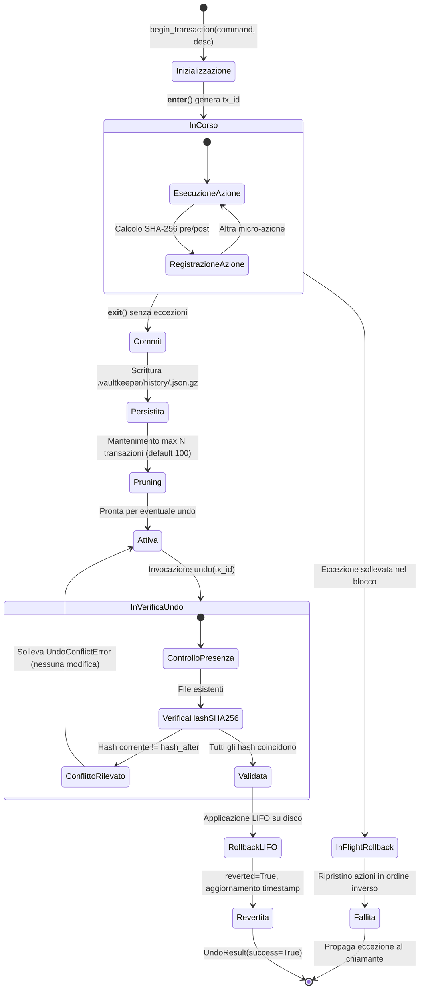
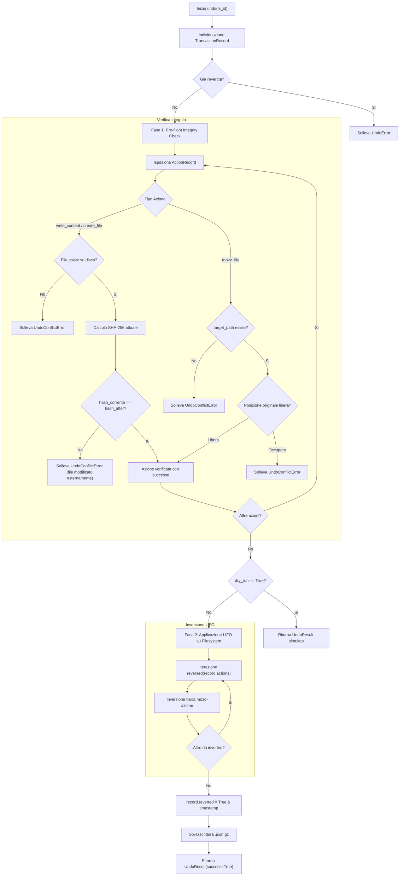

# Architettura del Transaction Journal e Rollback Engine

Il modulo [`src/vaultkeeper/core/journal.py`](file:///home/lucadileo9/scripts/obsidian-vaultkeeper/src/vaultkeeper/core/journal.py) implementa il motore transazionale di `obsidian-vaultkeeper`. 
Il suo obiettivo è fornire garanzie di affidabilità di tipo **ACID-like** (Atomicità, Consistenza, Isolamento logico, Durabilità) su normali file system (ext4, NTFS, APFS), senza richiedere l'installazione di database esterni come SQLite o PostgreSQL.

Ogni singola operazione di mutazione (creazione, rinomina, spostamento, archiviazione, offload, alterazione frontmatter, modifica tag) è gestita come una transazione atomica reversibile.

---

## 1. Il Problema Ingegneristico e i Requisiti di Sicurezza

La manipolazione di un Second Brain di oltre 3.900 note comporta rischi sistemici elevati:
- **Corruzione parziale**: Se una normalizzazione di massa dei nomi dei file si interrompe al 40% per un errore di permessi o un'interruzione di corrente, centinaia di wikilink rimangono spezzati.
- **Sovrascrittura accidentale (Lost Updates)**: Se l'utente tenta di annullare un'operazione eseguita ore prima su una nota che nel frattempo è stata modificata manualmente, un rollback cieco distruggerebbe il nuovo contenuto.
- **Dispersione di spazio**: Mantenere copie integrali di backup del Vault per ogni comando occuperebbe gigabyte di storage.

### I Principi Solutivi di VaultKeeper
1. **Delta Journaling compresso**: Vengono registrate unicamente le differenze pre/post stato e i percorsi, serializzati in JSON e compressi con Gzip in `.vaultkeeper/history/<tx_id>.json.gz`.
2. **Pre-flight Hash Matching (SHA-256)**: Prima di applicare qualsiasi rollback, il motore calcola l'impronta crittografica attuale dei file coinvolti e la confronta con lo stato registrato. Se c'è discrepanza, l'operazione viene abortita sollevando `UndoConflictError`.
3. **Inversione Topologica LIFO**: Le azioni che compongono la transazione vengono disfatte in ordine strettamente inverso rispetto a quello di esecuzione.
4. **Auto-Rollback In-Memory su Eccezione**: Se durante l'esecuzione di un blocco transazionale si verifica un errore non gestito, il context manager annulla istantaneamente tutte le micro-azioni già apportate su disco prima di propagare l'eccezione.

---

## 2. Diagramma degli Stati della Transazione

---

## 3. Componenti Chiave del Motore

### A. `compute_content_hash(text: Optional[str]) -> Optional[str]`
Calcola l'impronta crittografica SHA-256 del testo codificato in UTF-8. Restituisce `None` se il testo passato è `None` (es. file appena creato o eliminato).

---

### B. `TransactionContext`
Context manager generato da `TransactionJournal.begin_transaction()`. Governa il ciclo di vita delle micro-operazioni associate a un comando.

- **Attributi**:
  - `tx_id: str`: Identificativo cronologico e univoco (es. `tx_20261108_154012_123456_a1b2c3`).
  - `command: str`: Nome del comando scatenante (es. `"rename"`, `"normalize-names"`, `"create"`).
  - `description: str`: Descrizione discorsiva per l'audit log.
  - `actions: List[ActionRecord]`: Vettore ordinato delle azioni atomiche eseguite nel contesto.
  - `active: bool`: Indica se il contesto è attualmente in esecuzione.
  - `committed: bool`: Indica se la transazione è stata finalizzata e salvata su disco.

#### Metodi di Mutazione
- **`write_content(file_path, new_content, encoding="utf-8")`**:
  - Rileva se il file preesisteva su disco (`write_content`) o se è nuovo (`create_file`).
  - Calcola `hash_before` e `hash_after`.
  - Scrive il nuovo contenuto su disco creando preventivamente le cartelle madri se mancanti.
  - Accoda un'istanza di `ActionRecord`.
- **`create_file(file_path, content, encoding="utf-8")`**:
  - Alias semantico esplicito di `write_content`.
- **`move_file(source_path, dest_path)`**:
  - Verifica l'esistenza di `source_path` (solleva `JournalError` se assente).
  - Calcola l'hash binario SHA-256 del file prima dello spostamento.
  - Sposta fisicamente il file o directory tramite `shutil.move()`.
  - Registra l'azione con `action_type="move_file"`, `path=rel_src`, `target_path=rel_dest`.
- **`delete_file(file_path, soft=False, trash_folder=None)`**:
  - Se `soft=True`, delega a `move_file` trasferendo il file nella cartella `.trash/`.
  - Se `soft=False` (hard delete), memorizza il contenuto testuale o l'hash binario e invoca `unlink()`.

#### Meccanica di Auto-Rollback (`_rollback_in_memory`)
Se durante il blocco protetto dal context manager viene sollevata un'eccezione non intercettata:
1. `__exit__` rileva `exc_type is not None`.
2. Itera su `reversed(self.actions)`.
3. Per ogni azione:
   - Se era `write_content`: ripristina `content_before`.
   - Se era `create_file`: cancella il file appena creato (`unlink()`).
   - Se era `move_file`: riporta il file da `target_path` alla posizione originaria `path`.
   - Se era `delete_file`: riscrive `content_before` su disco.
4. Svuota il vettore `self.actions` ed esce senza salvare alcun file di transazione corrotto nel Journal.

---

### C. `TransactionJournal`
Classe supervisore responsabile della persistenza, consultazione e rollback delle transazioni.

- **Attributi**:
  - `root_path: Path`: Percorso assoluto della radice del Vault.
  - `max_transactions: int`: Numero massimo di file di storico conservati (default 100).
  - `history_dir: Path`: Directory `.vaultkeeper/history/` all'interno del Vault.

#### Metodi Principali

##### `begin_transaction(command: str, description: str = "") -> TransactionContext`
Genera una nuova istanza di `TransactionContext` pronta per essere utilizzata in una clausola `with`.

##### `list_transactions(limit: int = 20) -> List[TransactionRecord]`
Scansiona `.vaultkeeper/history/*.json.gz`, decomprime e deserializza i record, ordinandoli dal più recente al meno recente.

##### `get_transaction(tx_id: str) -> Optional[TransactionRecord]`
Carica e restituisce il record completo per uno specifico identificativo transazione.

##### `undo(tx_id: Optional[str] = None, dry_run: bool = False) -> UndoResult`
Annulla una transazione completata. 
Se `tx_id` non è specificato, individua automaticamente **la più recente transazione non ancora revertita**.

---

## 4. Algoritmo di Verifica Pre-Flight e Rollback (`undo`)

Il metodo `undo()` applica un rigoroso protocollo di sicurezza bifasico:

---

## 5. Politica di Pruning Automatico (`prune_history`)

Per prevenire la proliferazione indefinita di file storici su installazioni di lunga durata:
- A ogni salvataggio di transazione (`_save_transaction`), il journal invoca `prune_history(keep=self.max_transactions)`.
- Se il numero di file `.json.gz` supera la soglia (configurata tramite `max_undo_history` in `vault.toml`, default 100), i file più vecchi vengono eliminati selettivamente.
- Questa operazione garantisce che il footprint su disco dell'infrastruttura di journaling rimanga sempre confinato a pochi megabyte.
