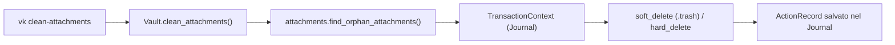
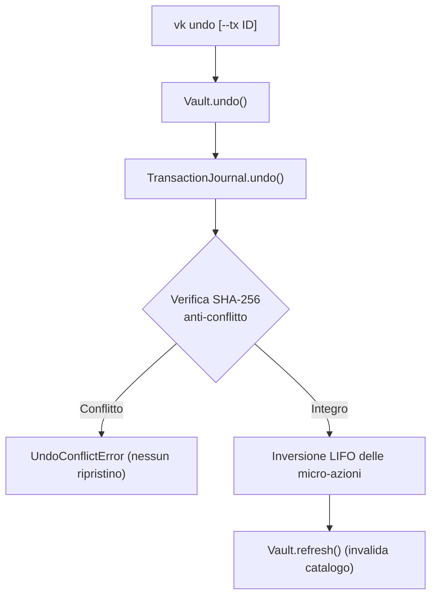
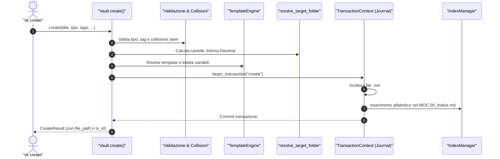

# Manuale di Riferimento dei Comandi CLI (`vk`)

Questo documento fornisce la specifica tecnica completa per ciascuno dei **20 comandi** esposti dalla CLI di `obsidian-vaultkeeper`. 
Per ciascun comando sono descritti: la finalità operativa, la sintassi completa, l'interazione con le classi interne del sistema, i codici di uscita ed esempi pratici di utilizzo.

---

## 1. `vk init`

Inizializza un file di configurazione predefinito `vault.toml` all'interno della cartella specificata o nella radice del Vault.

### Sintassi
```bash
vk init [--target DIRECTORY] [--force]
```
- `--target DIRECTORY`: Cartella in cui generare `vault.toml` (default: directory corrente o radice del Vault).
- `--force`: Sovrascrive il file se già presente.

### Interazione Architetturale
`handle_init()` $\rightarrow$ Genera il template TOML standard basato sui campi di [`VaultConfig`](file:///home/lucadileo9/scripts/obsidian-vaultkeeper/docs/architecture/models.md#vaultconfig) con commenti descrittivi.

### Codici di Uscita
- `0 (SUCCESS)`: File generato con successo.
- `1 (ERROR)`: File già esistente (senza `--force`) o errore di I/O.

### Esempio
```bash
vk init --target /srv/storage/Vault --force
```

---

## 2. `vk audit`

Esegue la suite diagnostica in 5 fasi del Second Brain, individua violazioni di governance e calcola il punteggio ponderato *Vault Health Score* (0.0 - 100.0).

### Sintassi
```bash
vk audit [--step {1,2,3,4,5}] [--json FILE] [--report-md FILE]
```
- `--step {1..5}`: Esegue esclusivamente la fase diagnostica indicata:
  - `1`: Storage & Filesystem (lunghezza percorsi, estensioni permesse, file pesanti).
  - `2`: Naming Conventions (conformità Title_Case).
  - `3`: Frontmatter & Types (blocco YAML, campi obbligatori, tipologia autorizzata).
  - `4`: Tag Taxonomy (verifica contro vocabolario controllato `00_Tassonomia_Tag.md`).
  - `5`: Links & Attachments (wikilink rotti, embed orfani, collisioni di stem).
- `--json FILE`: Salva il referto diagnostico completo in formato JSON.
- `--report-md FILE`: Salva un rapporto analitico formattato in Markdown per Obsidian.

### Interazione Architetturale
`handle_audit()` $\rightarrow$ [`Vault.audit()`](file:///home/lucadileo9/scripts/obsidian-vaultkeeper/docs/architecture/facade.md#auditphases-optionallistint--none---auditreport) $\rightarrow$ `run_audit()` in `audit.py` $\rightarrow$ Restituisce [`AuditReport`](file:///home/lucadileo9/scripts/obsidian-vaultkeeper/docs/architecture/models.md#auditreport).

### Codici di Uscita
- `0 (SUCCESS)`: Health Score pari a 100.0 e zero problematiche riscontrate.
- `2 (ISSUES_FOUND)`: Esecuzione completata ma sono state riscontrate problematiche o avvisi.

### Esempi
```bash
# Esecuzione completa con output visivo a terminale
vk audit

# Esecuzione della sola fase 3 (Frontmatter) con export JSON
vk audit --step 3 --json /tmp/audit_frontmatter.json
```

---

## 3. `vk check-links`

Scansiona tutte le note Markdown (o una cartella specifica) per individuare wikilink (`[[...]]`) ed embed multimediali (`![[...] ]`) non risolvibili all'interno del Vault.

### Sintassi
```bash
vk check-links [--target PATH]
```
- `--target PATH`: Circoscrive l'analisi a un singolo file `.md` o a una sottocartella.

### Interazione Architetturale
`handle_links()` $\rightarrow$ [`Vault.check_links()`](file:///home/lucadileo9/scripts/obsidian-vaultkeeper/docs/architecture/facade.md#check_linkstarget-optionalunionstr-path--none---listbrokenlink) $\rightarrow$ `scan_broken_links()` in `links.py` $\rightarrow$ Lista di [`BrokenLink`](file:///home/lucadileo9/scripts/obsidian-vaultkeeper/docs/architecture/models.md#brokenlink).

### Codici di Uscita
- `0 (SUCCESS)`: Zero link rotti rilevati.
- `2 (ISSUES_FOUND)`: Individuati uno o più collegamenti orfani.

### Esempio
```bash
vk check-links --target 20-29_Istruzione/
```

---

## 4. `vk clean-attachments`

Ispeziona le cartelle dedicate agli allegati (`_attachments`, `media`, ecc.) e bonifica i file binari che non risultano citati in alcuna nota del Vault.

### Sintassi
```bash
vk clean-attachments [--target PATH] [--dry-run] [--hard-delete]
```
- `--target PATH`: Cartella specifica in cui cercare allegati orfani.
- `--dry-run`: Mostra l'elenco dei file orfani senza apportare modifiche su disco.
- `--hard-delete`: Elimina fisicamente i file invece di spostarli nella directory reversibile `.trash/`.

### Interazione Architetturale


### Reversibilità
**Completamente reversibile tramite `vk undo`** (sia in caso di soft-delete che di hard-delete su file di testo).

### Codici di Uscita
- `0 (SUCCESS)`: Bonifica o simulazione completata.
- `1 (ERROR)`: Errore di filesystem o percorso inesistente.

### Esempio
```bash
# Anteprima sicura
vk clean-attachments --dry-run

# Bonifica effettiva con soft-delete reversibile
vk clean-attachments
```

---

## 5. `vk normalize-names`

Normalizza ricorsivamente tutti i nomi di file secondo la convenzione `Title_Case_Con_Underscore`, preservando i prefissi numerici Johnny.Decimal (es. `10-19_`) e gli acronimi protetti (`AI`, `CRM`, `BCG`). **Tutti i wikilink interni in ingresso vengono contestualmente aggiornati nell'intero Vault**.

### Sintassi
```bash
vk normalize-names [--target DIR] [--dry-run]
```
- `--target DIR`: Circoscrive l'operazione a una sottocartella specifica.
- `--dry-run`: Anteprima dettagliata dei file che verrebbero rinominati e del numero di backlink da aggiornare.

### Interazione Architetturale
`handle_naming()` $\rightarrow$ [`Vault.normalize_names()`](file:///home/lucadileo9/scripts/obsidian-vaultkeeper/docs/architecture/facade.md#normalize_namestargetnone-dry_runfalse---listtuplepath-path-int) $\rightarrow$ `batch_normalize()` in `naming.py` con registrazione automatica nel Journal.

### Reversibilità
**Completamente reversibile tramite `vk undo`**. L'undo ripristina sia i vecchi nomi sia tutti i wikilink riscritti.

### Esempio
```bash
vk normalize-names --target 10-19_Progetti/ --dry-run
```

---

## 6. `vk generate-indices`

Genera o risincronizza i file MOC (`00_Indice.md` o `00_Indice_<Cartella>.md`) aggregando le note per tipologia con abstract estratti da frontmatter, callout o primi paragrafi.

### Sintassi
```bash
vk generate-indices [--target DIR] [--all] [--dry-run]
```
- `--target DIR`: Cartella specifica in cui aggiornare l'indice.
- `--all`: Propaga ricorsivamente la generazione a tutte le sottocartelle dell'albero decimale.
- `--dry-run`: Mostra il contenuto generato senza salvarlo su disco.

### Interazione Architetturale
`handle_indices()` $\rightarrow$ [`Vault.generate_indices()`](file:///home/lucadileo9/scripts/obsidian-vaultkeeper/docs/architecture/facade.md#generate_indicestargetnone-recursivetrue-dry_runfalse---listtuplepath-bool) $\rightarrow$ `IndexManager.rebuild_index()` in `indices.py`.

### Esempio
```bash
vk generate-indices --target 20-29_Istruzione/ --all
```

---

## 7. `vk frontmatter`

Sottocomando per l'ispezione e la manipolazione controllata dei metadati YAML conformemente alla governance del Vault.

### Sottocomandi Esposti
1. **`set-type`**: Imposta o aggiorna il campo tipologico (`tipo`).
   ```bash
   vk frontmatter set-type --target NOTA.md --type Appunto [--dry-run]
   ```
2. **`add-tags`**: Inietta uno o più tag nel frontmatter.
   ```bash
   vk frontmatter add-tags --target NOTA.md --tags tech/python area/dev [--overwrite] [--dry-run]
   ```
   - `--overwrite`: Sostituisce i tag esistenti invece di accodarli.
3. **`sanitize-tags`**: Riscrive i tag obsoleti mappandoli secondo le regole di `config.tag_replacements`.
   ```bash
   vk frontmatter sanitize-tags [--target DIR] [--dry-run]
   ```

### Reversibilità
Tutte le modifiche al frontmatter sono incapsulate in transazioni e **reversibili tramite `vk undo`**.

---

## 8. `vk disambiguate`

Individua e segnala collisioni di stem tra cartelle diverse, che impedirebbero a Obsidian di risolvere in modo univoco i wikilink non qualificati da percorso.

### Sintassi
```bash
vk disambiguate [--target DIR] [--dry-run]
```

### Interazione Architetturale
`handle_disambiguate()` $\rightarrow$ [`Vault.stem_collisions()`](file:///home/lucadileo9/scripts/obsidian-vaultkeeper/docs/architecture/facade.md#stem_collisions---dictstr-listpath) $\rightarrow$ `find_stem_collisions()` in `links.py`.

### Esempio
```bash
vk disambiguate
```

---

## 9. `vk history`

Interroga lo storico delle transazioni atomiche registrate nel Journal in `.vaultkeeper/history/*.json.gz`.

### Sintassi
```bash
vk history [--limit N] [--format {md,json,yaml,csv}]
```
- `--limit N`: Numero massimo di transazioni da estrarre (default: 20).
- `--format`: Formato di rendering tabellare o serializzato.

### Interazione Architetturale
`handle_history()` $\rightarrow$ [`Vault.history()`](file:///home/lucadileo9/scripts/obsidian-vaultkeeper/docs/architecture/facade.md#historylimit-int--20---listtransactionrecord) $\rightarrow$ `TransactionJournal.list_transactions()`.

### Esempio
```bash
vk history --limit 5 --format md
```

---

## 10. `vk undo`

Annulla una transazione completata ripristinando integralmente lo stato del filesystem e del contenuto testuale, previa verifica crittografica SHA-256 anti-conflitto.

### Sintassi
```bash
vk undo [--tx ID_TRANSAZIONE] [--dry-run]
```
- `--tx ID_TRANSAZIONE`: Identificativo specifico (es. `tx_20261108_143015_...`). Se omesso, annulla **l'ultima transazione attiva non ancora revertita**.
- `--dry-run`: Verifica la fattibilità del rollback e gli hash SHA-256 senza toccare i file.

### Interazione Architetturale


### Esempio
```bash
# Anteprima sicura del rollback
vk undo --dry-run

# Esecuzione effettiva
vk undo
```

---

## 11. `vk rename`

Rinomina un file o un appunto Markdown garantendo la normalizzazione dello stem, il pre-flight check sulle collisioni, l'aggiornamento simultaneo di tutti i wikilink in ingresso nel Vault e la sincronizzazione del MOC di cartella.

### Sintassi
```bash
vk rename FILE NUOVO_NOME [--skip-links] [--dry-run]
```
- `FILE`: Percorso del file da rinominare.
- `NUOVO_NOME`: Nuovo nome o stem (con o senza estensione `.md`).
- `--skip-links`: Rinomina solo il file fisico saltando la riscrittura dei wikilink nel Vault.
- `--dry-run`: Simula l'operazione visualizzando i link che verrebbero aggiornati.

### Interazione Architetturale
`handle_rename()` $\rightarrow$ [`Vault.rename()`](file:///home/lucadileo9/scripts/obsidian-vaultkeeper/docs/architecture/facade.md#renameold_path-new_name-skip_linksfalse-dry_runfalse---renameresult) $\rightarrow$ Restituisce [`RenameResult`](file:///home/lucadileo9/scripts/obsidian-vaultkeeper/docs/architecture/models.md#renameresult).

### Esempio
```bash
vk rename 10-19_Progetti/vecchio_progetto.md Progetto_Varys --dry-run
```

---

## 12. `vk move`

Sposta una nota o una cartella in una directory decimale differente, aggiornando sia l'indice MOC della cartella di origine che quello della cartella di arrivo.

### Sintassi
```bash
vk move BERSAGLIO DESTINAZIONE [--dry-run]
```
- `BERSAGLIO`: File o directory da spostare.
- `DESTINAZIONE`: Cartella di arrivo.
- `--dry-run`: Anteprima dello spostamento.

### Reversibilità
**Reversibile al 100% con `vk undo`**.

### Esempio
```bash
vk move 20-29_Istruzione/Architettura.md 10-19_Progetti/
```

---

## 13. `vk archive`

Trasferisce un progetto o una risorsa conclusa verso il Cold Storage (`/srv/storage/Archive`). Crea opzionalmente una scheda tombstone nel Vault originario contenente un estratto sintetico e un puntamento storico all'archivio.

### Sintassi
```bash
vk archive BERSAGLIO [--no-tombstone] [--dry-run]
```
- `BERSAGLIO`: File o cartella da archiviare.
- `--no-tombstone`: Non deposita la nota tombstone nel Vault attivo.
- `--dry-run`: Simula l'archiviazione senza muovere file.

### Interazione Architetturale
`handle_archive()` $\rightarrow$ [`Vault.archive()`](file:///home/lucadileo9/scripts/obsidian-vaultkeeper/docs/architecture/facade.md#archiveitem_path-no_tombstonefalse-dry_runfalse---archiveresult) $\rightarrow$ Restituisce [`ArchiveResult`](file:///home/lucadileo9/scripts/obsidian-vaultkeeper/docs/architecture/models.md#archiveresult).

### Esempio
```bash
vk archive 10-19_Progetti/Progetto_Legacy/
```

---

## 14. `vk offload`

Identifica file binari pesanti (>50MB o target specificato), li sposta nell'archivio a freddo e sostituisce i riferimenti inline con schede di puntamento esterno per alleggerire il Vault.

### Sintassi
```bash
vk offload [BERSAGLIO] [--dry-run]
```
- `BERSAGLIO`: File o cartella specifica (se omesso, analizza tutti i file del Vault che superano la soglia).
- `--dry-run`: Simula l'offload visualizzando i megabyte risparmiati.

### Esempio
```bash
vk offload --dry-run
```

---

## 15. `vk tags`

Gestisce il vocabolario controllato della tassonomia memorizzato in `00_Tassonomia_Tag.md`.

### Sottocomandi
1. **`show`**: Visualizza i tag censiti, filtrabili per stringa di ricerca.
   ```bash
   vk tags show [--query RICERCA] [--format {md,json,yaml,csv}]
   ```
2. **`add`**: Inserisce un nuovo tag in ordine alfabetico sotto la sezione desiderata.
   ```bash
   vk tags add tech/rust [--section "Tecnologia"] [--dry-run]
   ```
3. **`remove`**: Rimuove un tag dalla tassonomia e da tutte le note che lo utilizzano.
   ```bash
   vk tags remove tech/obsoleto [--force] [--dry-run]
   ```
   - Se il tag è ancora citato in note e non si usa `--force`, l'operazione viene bloccata.

---

## 16. `vk config`

Ispeziona o aggiorna a caldo le direttive del file di configurazione `vault.toml`.

### Sottocomandi
1. **`show`**: Mostra la configurazione attiva in formato strutturato.
   ```bash
   vk config show [--format {yaml,json,md}]
   ```
2. **`set`**: Modifica un valore applicando inferenza automatica di tipo (booleani, interi, float, stringhe).
   ```bash
   vk config set max_path_length 250 [--dry-run]
   ```

---

## 17. `vk search`

Motore di ricerca full-text combinatorio e semantico su tutto il Vault.

### Sintassi
```bash
vk search [QUERY] [--tag TAG] [--type TIPO] [--links-to STEM] [--folder CARTELLA] [--format {md,json,yaml,csv}]
```
- `QUERY`: Termine testuale da cercare nel titolo o corpo delle note.
- `--tag`: Filtro per tag (es. `tech/python`).
- `--type`: Filtro per tipologia di nota (es. `Appunto`, `Progetto`).
- `--links-to`: Filtro per note che citano lo stem specificato (ricerca backlink).
- `--folder`: Circoscrive la ricerca a una specifica cartella decimale.

### Esempio
```bash
# Ricerca combinata: note di tipo Progetto con tag 'ai' collegate a 'ThinkStation'
vk search --type Progetto --tag ai --links-to ThinkStation
```

---

## 18. `vk graph-health`

Esegue l'analisi topologica della rete dei concetti di Obsidian, identificando note centrali (*hubs*), vicoli ciechi (*dead-ends*), note completamente isolate (*true orphans*) e componenti sconnesse.

### Sintassi
```bash
vk graph-health [--format {md,json,yaml}]
```

### Esempio
```bash
vk graph-health --format md
```

---

## 19. `vk map`

Genera la cartografia quantitativa dell'albero decimale Johnny.Decimal (conteggio note, allegati, megabyte occupati e verifica presenza dei MOC `00_Indice.md`).

### Sintassi
```bash
vk map [--output MAPPA.md] [--format {md,json}]
```
- `--output MAPPA.md`: Salva la mappa in un appunto Markdown conforme al Vault.

### Esempio
```bash
vk map --output 00-09_Meta/Mappa_Vault.md
```

---

## 20. `vk create`

Crea una nuova nota standardizzata applicando validazione preventiva, risoluzione del template appropriato, auto-routing Johnny.Decimal e inserimento automatico nel MOC di cartella.

### Sintassi
```bash
vk create TITOLO --type TIPO [--folder CARTELLA] [--tags TAGS] [--template TEMPLATE] [--dry-run] [--format {md,json,yaml,csv}]
```
- `TITOLO`: Titolo discorsivo dell'appunto (es. `"Architettura Microservizi"`).
- `--type TIPO`: Tipologia obbligatoria (`Appunto`, `Progetto`, `Contatto`, `Risorsa`, `Sistema`).
- `--folder CARTELLA`: Cartella esplicita. Se omessa, applica l'**auto-routing Johnny.Decimal** (`Progetto` $\rightarrow$ `10-19_Progetti`, `Contatto` $\rightarrow$ `30-39_Carriera/32_CRM`, ecc.).
- `--tags TAGS`: Tag separati da virgola (validati preventivamente contro la tassonomia se `strict_taxonomy=True`).
- `--template TEMPLATE`: Nome o percorso di un template personalizzato. Se omesso, seleziona il template predefinito per la tipologia.
- `--dry-run`: Simula la generazione senza scrivere il file né aggiornare l'indice.

### Flusso Operativo


### Reversibilità
**Completamente reversibile tramite `vk undo`**: il rollback cancella la nota creata e rimuove contestualmente la riga aggiunta nel file `00_Indice.md`.

### Esempi
```bash
# Creazione standard con auto-routing in 20-29_Istruzione/
vk create "Algoritmi di Consenso Paxos" --type Appunto --tags "tech/distributed,uni/sistemi"

# Creazione contatto CRM con auto-routing in 30-39_Carriera/32_CRM/
vk create "Mario Rossi" --type Contatto --tags "network/consulenza"
```
