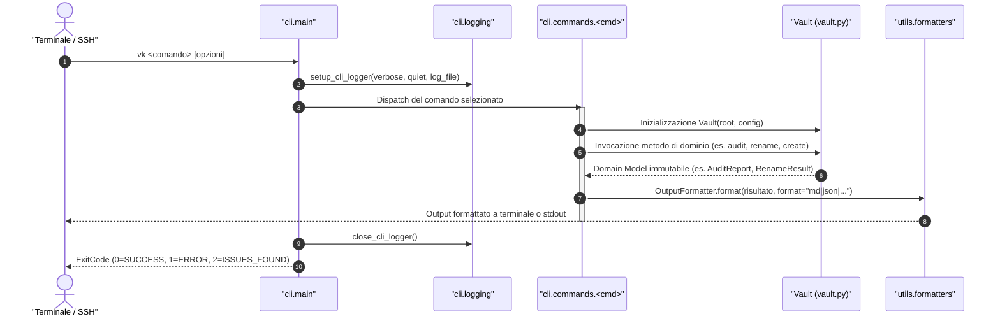

# Panoramica della CLI (`vk`)

La Command Line Interface **`vk`** (definita in [`src/vaultkeeper/cli/`](file:///home/lucadileo9/scripts/obsidian-vaultkeeper/src/vaultkeeper/cli)) è il punto di contatto operativo per la gestione quotidiana, l'igiene e l'automazione del Second Brain Obsidian sul server ThinkStation P2.

Costruita su `argparse` e integrata con formattatori `Rich` e serializzatori strutturati (JSON, YAML, CSV), la CLI funge da presentation layer sottile e non invasivo: non implementa logica di dominio, ma delega interamente le operazioni alla Facade [`Vault`](file:///home/lucadileo9/scripts/obsidian-vaultkeeper/docs/architecture/facade.md).

---

## 1. Ciclo di Esecuzione Globale della CLI



---

## 2. Opzioni Globali

Le opzioni globali possono essere anteposte a qualsiasi sottocomando:

| Opzione | Tipo | Predefinito | Descrizione |
| :--- | :--- | :--- | :--- |
| `-v`, `--verbose` | Flag | `False` | Attiva l'output di debug dettagliato per tracciare le chiamate interne. |
| `-q`, `--quiet` | Flag | `False` | Sopprime le intestazioni e i log informativi, stampando solo gli errori critici. |
| `--log-file` | `str` | `None` | Percorso opzionale di un file di log per registrare la cronologia delle operazioni. |
| `--root` | `str` | `None` | Forza il percorso assoluto della radice del Vault (sovrascrive il rilevamento automatico). |
| `--config` | `str` | `None` | Specifica un percorso personalizzato per il file di configurazione (`vault.toml`). |
| `--version` | Flag | - | Visualizza la versione installata del pacchetto ed esce. |
| `-h`, `--help` | Flag | - | Visualizza il manuale dell'argomento o del sottocomando selezionato. |

---

## 3. Codici di Uscita Standard (`ExitCode`)

I codici di ritorno restituiti al sistema operativo (definiti in [`src/vaultkeeper/cli/constants.py`](file:///home/lucadileo9/scripts/obsidian-vaultkeeper/src/vaultkeeper/cli/constants.py)) seguono la convenzione POSIX per consentire un'integrazione robusta in script bash, pipe o pipeline di Continuous Integration:

```python
class ExitCode(IntEnum):
    SUCCESS = 0       # Operazione completata con successo, zero problemi riscontrati
    ERROR = 1         # Errore irreversibile, eccezione sollevata o parametri non validi
    ISSUES_FOUND = 2  # Comando diagnostico completato, ma sono state rilevate anomalie
```

- **`0 (SUCCESS)`**: L'operazione richiesta ha avuto esito positivo (es. nota creata, file rinominato, transazione annullata o audit al 100%).
- **`1 (ERROR)`**: Errore di esecuzione bloccante (es. file non trovato, collisione di stem, violazione tassonomica, sintassi errata).
- **`2 (ISSUES_FOUND)`**: Restituito specificamente da `vk audit` o `vk check-links` quando la scansione termina regolarmente ma vengono individuate violazioni o link rotti da sanare.

---

## 4. Modalità di Simulazione di Sicurezza (`--dry-run`)

Tutti i comandi con effetti collaterali distruttivi o mutativi sul filesystem supportano il flag `--dry-run`:
- `clean-attachments --dry-run`
- `normalize-names --dry-run`
- `generate-indices --dry-run`
- `rename --dry-run`
- `move --dry-run`
- `archive --dry-run`
- `offload --dry-run`
- `tags add/remove --dry-run`
- `config set --dry-run`
- `create --dry-run`
- `undo --dry-run`

Quando `--dry-run` è attivo:
1. Viene eseguito l'intero flusso di preflight (parsing, calcolo target, rilevamento collisioni e validazione tassonomica).
2. **Nessun byte viene scritto o spostato su disco**.
3. **Nessuna transazione viene registrata nel Journal**.
4. Il terminale mostra esattamente cosa verrebbe modificato, consentendo all'utente o a script supervisori di verificare l'azione prima dell'effettiva esecuzione.

---

## 5. Formati di Output Strutturati (`--format`)

La maggior parte dei comandi supporta la selezione del formato di output:
- **`md` (predefinito)**: Output tabellare Markdown ottimizzato per la lettura da terminale o l'inclusione diretta in note di Obsidian.
- **`json`**: Struttura JSON deterministica adatta all'interrogazione tramite `jq` o integrazione in script di automazione.
- **`yaml`**: Output YAML leggibile per configurazioni o metadati.
- **`csv`**: Output tabellare separato da virgole per importazioni analitiche in fogli di calcolo.

---

## 6. Quick Reference Table dei 20 Comandi

| Comando CLI | Sintassi Tipica | Finalità Operativa | Reversibile (`undo`) |
| :--- | :--- | :--- | :---: |
| **`init`** | `vk init [--force]` | Genera il file di configurazione predefinito `vault.toml`. | No |
| **`audit`** | `vk audit [--step 1..5] [--json out.json]` | Esegue la diagnostica in 5 fasi e calcola il Vault Health Score. | No (Read-Only) |
| **`check-links`** | `vk check-links [--target path]` | Rileva wikilink rotti ed embed multimediali orfani. | No (Read-Only) |
| **`clean-attachments`** | `vk clean-attachments [--hard-delete] [--dry-run]` | Sposta allegati orfani in `.trash` o li elimina definitivamente. | **Sì** |
| **`normalize-names`** | `vk normalize-names [--target dir] [--dry-run]` | Rinomina i file in `Title_Case` e aggiorna i wikilink correlati. | **Sì** |
| **`generate-indices`** | `vk generate-indices [--target dir] [--all] [--dry-run]` | Genera o aggiorna i file MOC `00_Indice.md` di cartella. | No (Idempotente) |
| **`frontmatter`** | `vk frontmatter set-type --target n.md --type Appunto` | Ispeziona o altera metadati YAML (`tipo`, tag). | **Sì** |
| **`disambiguate`** | `vk disambiguate [--target dir]` | Mappa collisioni di stem o ambiguità di puntamento tra cartelle. | No (Read-Only) |
| **`history`** | `vk history [--limit 20] [--format json]` | Mostra lo storico delle transazioni atomiche registrate. | No (Read-Only) |
| **`undo`** | `vk undo [--tx id] [--dry-run]` | Annulla l'ultima transazione (o quella specificata da `--tx`). | **Sì** (Rollback) |
| **`rename`** | `vk rename vecchio.md Nuovo.md [--skip-links]` | Rinomina una nota con refactoring globale dei backlink. | **Sì** |
| **`move`** | `vk move nota.md 10-19_Progetti/` | Sposta file o cartelle aggiornando i rispettivi MOC. | **Sì** |
| **`archive`** | `vk archive Progetto_X/ [--no-tombstone]` | Trasferisce in cold storage e deposita scheda tombstone. | **Sì** |
| **`offload`** | `vk offload [target] [--dry-run]` | Sposta allegati >50MB in cold storage sostituendo i link. | **Sì** |
| **`tags`** | `vk tags add tech/python [--section Sezione]` | Gestisce la tassonomia controllata in `00_Tassonomia_Tag.md`. | **Sì** |
| **`config`** | `vk config set naming.style Title_Case` | Ispeziona o modifica impostazioni a caldo in `vault.toml`. | **Sì** |
| **`search`** | `vk search "query" [--tag t] [--type Appunto]` | Ricerca full-text e combinatoria multi-criterio. | No (Read-Only) |
| **`graph-health`** | `vk graph-health [--format json]` | Analisi topologica del grafo (orfani, hub, vicoli ciechi). | No (Read-Only) |
| **`map`** | `vk map [--output Mappa.md] [--format json]` | Cartografia strutturale Johnny.Decimal e volumi del Vault. | No (Read-Only) |
| **`create`** | `vk create "Titolo" --type Appunto [--tags ...]` | Creazione standardizzata con auto-routing e templating. | **Sì** |
