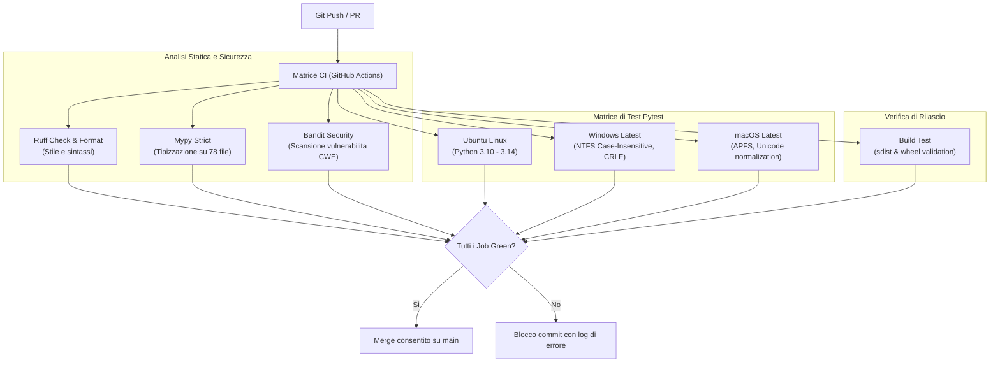

# Architettura della Test Suite e Qualità del Codice

La suite di test di `obsidian-vaultkeeper` (collocata in [`tests/`](file:///home/lucadileo9/scripts/obsidian-vaultkeeper/tests)) è concepita per garantire che nessuna operazione di manutenzione, rifattorizzazione o normalizzazione possa mai corrompere l'integrità del Second Brain.

L'intera infrastruttura di test rispetta tre invarianti fondamentali:
1. **Zero Effetti Collaterali (Isolamento Ermetico)**: Nessun test tocca o legge mai il Vault reale in `/srv/storage/Vault`. Tutte le esecuzioni avvengono all'interno di ambienti temporanei effimeri generati al volo da fixture pytest.
2. **Determinismo e Velocità**: Tutti i 153 test vengono eseguiti in meno di 0.8 secondi su Linux, consentendo feedback immediato prima di ogni commit.
3. **Copertura Rigorosa ($\ge 90\%$)**: Qualsiasi modulo nuovo o modificato deve superare la soglia minima del 90% di copertura di codice, verificata tramite `pytest-cov`.

---

## 1. Pipeline di Continuous Integration (CI)

Ogni push e pull request viene validato su una matrice multi-piattaforma orchestrata da GitHub Actions ([`.github/workflows/ci.yml`](file:///home/lucadileo9/scripts/obsidian-vaultkeeper/.github/workflows/ci.yml)):



---

## 2. Metriche di Qualità e Copertura

I controlli eseguiti localmente e in CI impongono standard industriali rigorosi:

| Strumento | Ambito di Controllo | Requisito / Soglia | Esito Attuale |
| :--- | :--- | :--- | :---: |
| **Pytest + Coverage** | Esecuzione test unitari e di integrazione | Copertura $\ge 90\%$ | **153/153 passati (90%)** |
| **Mypy** | Controllo statico dei tipi in modalità strict | 0 errori di tipo | **0 errori su 78 file** |
| **Ruff Check** | Analisi statica del codice (Flake8, Pyflakes, Bugbear) | 0 warning | **0 violazioni** |
| **Ruff Format** | Formattazione deterministica del codice (Black-compatible) | 100% conforme | **78 file formattati** |
| **Bandit** | Rilevamento vulnerabilità di sicurezza (CWE, unsafe tempfiles) | 0 problemi rilevati | **0 vulnerabilità** |

---

## 3. Design delle Fixture Pytest (`tests/conftest.py`)

La gestione degli ambienti di test simula l'esatta conformità dell'albero decimale di un Second Brain Obsidian:

### `temp_vault`
- Genera una directory temporanea isolata con `tempfile.TemporaryDirectory`.
- Risolve il percorso con `Path.resolve()` per prevenire discrepanze di percorsi abbreviati su Windows (`RUNNER~1` vs `runneradmin`).
- Costruisce la struttura standard Johnny.Decimal:
  - `00-09_Meta/02_Template/` con template ufficiali (`Template_Appunto.md`, `Template_Progetto.md`, `Template_Contatto.md`).
  - `00_Tassonomia_Tag.md` con sezioni semantiche e tag registrati.
  - Note di test nelle cartelle `10-19_Progetti/`, `20-29_Istruzione/`, `30-39_Carriera/32_CRM/`.
  - Cartelle allegati dedicate (`_attachments/`) con immagini e documenti simulati.
  - File MOC `00_Indice.md` pre-compilati per verificare gli algoritmi di aggiornamento incrementale.
- Al termine dell'esecuzione, la teardown pulisce l'ambiente gestendo eventuali file lock su Windows (`ignore_cleanup_errors=True`).

### `temp_archive`
- Simula il Cold Storage speculare `/srv/storage/Archive` per testare le funzioni di archiviazione (`vk archive`) e scarico di file pesanti (`vk offload`).

---

## 4. Catalogo Modulare dei File di Test

I 153 test sono ripartiti in 17 moduli tematici:

### A. Modelli e Configurazione
- [`tests/test_config.py`](file:///home/lucadileo9/scripts/obsidian-vaultkeeper/tests/test_config.py) (9 test): Caricamento di `vault.toml`, valori predefiniti, override a runtime, sollevamento eccezioni su file mancanti, serializzazione dei modelli di base.

### B. Core Computazionale e Documenti
- [`tests/test_document.py`](file:///home/lucadileo9/scripts/obsidian-vaultkeeper/tests/test_document.py) (9 test): Manipolazione di `MarkdownDocument`, preservazione dei ritorni a capo (CRLF/LF), sostituzione selettiva di wikilink, mutazione dei tag nel frontmatter.
- [`tests/test_frontmatter.py`](file:///home/lucadileo9/scripts/obsidian-vaultkeeper/tests/test_frontmatter.py) (10 test): Parsing YAML conforme ad Obsidian, protezione delle direttive C (`#include`) e dei colori esadecimali (`#FFFFFF`) dall'estrazione di falsi tag.
- [`tests/test_naming.py`](file:///home/lucadileo9/scripts/obsidian-vaultkeeper/tests/test_naming.py) (8 test): Normalizzazione `Title_Case_Con_Underscore`, rimozione caratteri illegali, protezione di acronimi (`AI`, `BCG`, `CRM`, `MECE`) e prefissi numerici Johnny.Decimal.
- [`tests/test_links.py`](file:///home/lucadileo9/scripts/obsidian-vaultkeeper/tests/test_links.py) (5 test): Risoluzione wikilink secondo Obsidian (stems senza percorsi, target relativi, ancore `#` e alias `|`), scansione di link rotti e collisioni di stem.
- [`tests/test_attachments.py`](file:///home/lucadileo9/scripts/obsidian-vaultkeeper/tests/test_attachments.py) (5 test): Rilevamento allegati orfani, file pesanti (>50MB), cancellazione reversibile (soft-delete in `.trash/`) ed eliminazione definitiva protetta dal Journal.
- [`tests/test_indices.py`](file:///home/lucadileo9/scripts/obsidian-vaultkeeper/tests/test_indices.py) (7 test): Generazione contestuale dei file MOC `00_Indice.md`, raggruppamento per tipologia di nota, estrazione di abstract da callout e frontmatter, inserimento e cancellazione atomica.

### C. Motore Transazionale e Rollback
- [`tests/test_journal.py`](file:///home/lucadileo9/scripts/obsidian-vaultkeeper/tests/test_journal.py) (12 test): Creazione e salvataggio compresso delle transazioni (`.json.gz`), inversione LIFO delle micro-azioni, auto-rollback in-memory in caso di eccezione nel context manager, rilevamento di conflitti SHA-256 (rifiuto di annullare file modificati successivamente) e pruning automatico.

### D. Ciclo di Vita Avanzato e Creazione Note
- [`tests/test_lifecycle.py`](file:///home/lucadileo9/scripts/obsidian-vaultkeeper/tests/test_lifecycle.py) (12 test): Rinomina con propagazione globale dei backlink, spostamenti tra cartelle decimale con doppio update dei MOC, archiviazione a freddo con generazione di schede tombstone, offload di allegati pesanti e riscrittura dei collegamenti.
- [`tests/test_templates.py`](file:///home/lucadileo9/scripts/obsidian-vaultkeeper/tests/test_templates.py) (12 test): Risoluzione dei template per tipologia, rendering di variabili dinamiche (`{{title}}`, `{{date}}`, `{{stem}}`), auto-routing Johnny.Decimal verso la cartella corretta, preflight checks anti-collisione e creazione standardizzata.

### E. Tassonomia, Diagnostica e Telemetria
- [`tests/test_taxonomy.py`](file:///home/lucadileo9/scripts/obsidian-vaultkeeper/tests/test_taxonomy.py) (6 test): Caricamento tassonomia, validazione tag, inserimento alfabetico ordinato sotto la sezione di competenza, rimozione sicura con controllo delle dipendenze.
- [`tests/test_audit.py`](file:///home/lucadileo9/scripts/obsidian-vaultkeeper/tests/test_audit.py) (4 test): Diagnostica integrata in 5 fasi, calcolo matematico ponderato dell'Health Score (0.0 - 100.0), penalità graduate per violazioni critiche e avvisi minori.
- [`tests/test_search.py`](file:///home/lucadileo9/scripts/obsidian-vaultkeeper/tests/test_search.py) (3 test): Ricerca combinata per query testuale, tag, tipo, cartella e backlink, estrazione di snippet di contesto ed esportazione in dizionario serializzabile.
- [`tests/test_map.py`](file:///home/lucadileo9/scripts/obsidian-vaultkeeper/tests/test_map.py) (2 test): Generazione della telemetria delle aree Johnny.Decimal e rendering della mappa in formato Markdown conforme ad Obsidian.
- [`tests/test_vault.py`](file:///home/lucadileo9/scripts/obsidian-vaultkeeper/tests/test_vault.py) (6 test): Verifica dell'API Facade ad alto livello [`Vault`](file:///home/lucadileo9/scripts/obsidian-vaultkeeper/docs/architecture/facade.md).

### F. Presentation Layer CLI End-to-End
- [`tests/test_cli.py`](file:///home/lucadileo9/scripts/obsidian-vaultkeeper/tests/test_cli.py) (10 test): Test end-to-end dei comandi base (`init`, `audit`, `check-links`, `clean-attachments`, `normalize-names`, `generate-indices`, `frontmatter`, `disambiguate`, logging su file).
- [`tests/test_cli_create.py`](file:///home/lucadileo9/scripts/obsidian-vaultkeeper/tests/test_cli_create.py) (5 test): Creazione via CLI con template, auto-routing, rollback atomico con `vk undo`, simulazione `--dry-run`, formati esportabili e gestione errori.
- [`tests/test_cli_history_undo.py`](file:///home/lucadileo9/scripts/obsidian-vaultkeeper/tests/test_cli_history_undo.py) (7 test): Workflow completo di esecuzione comandi mutativi e ripristino sequenziale con `vk undo`, rilevamento di conflitti e formattazione della cronologia.
- [`tests/test_cli_lifecycle.py`](file:///home/lucadileo9/scripts/obsidian-vaultkeeper/tests/test_cli_lifecycle.py) (8 test): Esecuzione CLI di `rename`, `move`, `archive`, `offload` con verifica del rollback tramite `undo`.
- [`tests/test_cli_milestone3.py`](file:///home/lucadileo9/scripts/obsidian-vaultkeeper/tests/test_cli_milestone3.py) (6 test): Esecuzione CLI di `tags`, `config`, `search`, `graph-health`, `map` e validazione dei codici di uscita `ExitCode`.

---

## 5. Esecuzione dei Test e Strumenti di Sviluppo

Per eseguire l'intera suite di test e le verifiche di qualità in locale:

```bash
# Esecuzione completa dei 153 test con report di copertura del codice
.venv/bin/pytest --cov=vaultkeeper --cov-report=term-missing

# Esecuzione rapida senza coverage
.venv/bin/pytest

# Controllo statico dei tipi con Mypy
.venv/bin/mypy src/ tests/

# Controllo di stile e linting con Ruff
.venv/bin/ruff check src/ tests/

# Verifica di formattazione
.venv/bin/ruff format --check src/ tests/

# Scansione di sicurezza per vulnerabilità CWE con Bandit
.venv/bin/bandit -r src/ -ll
```
